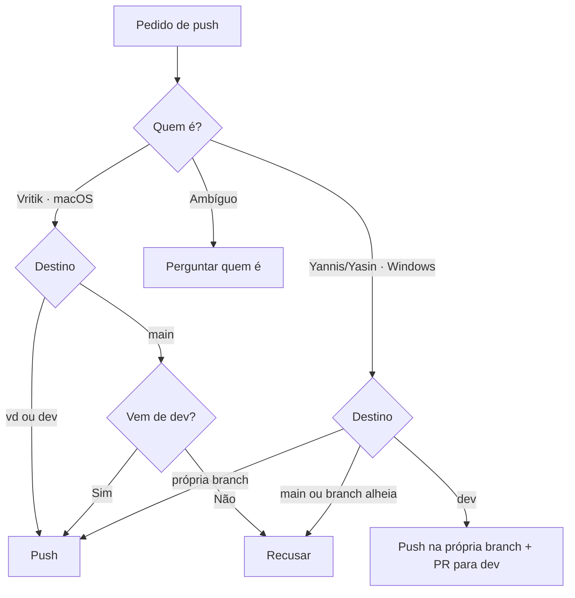
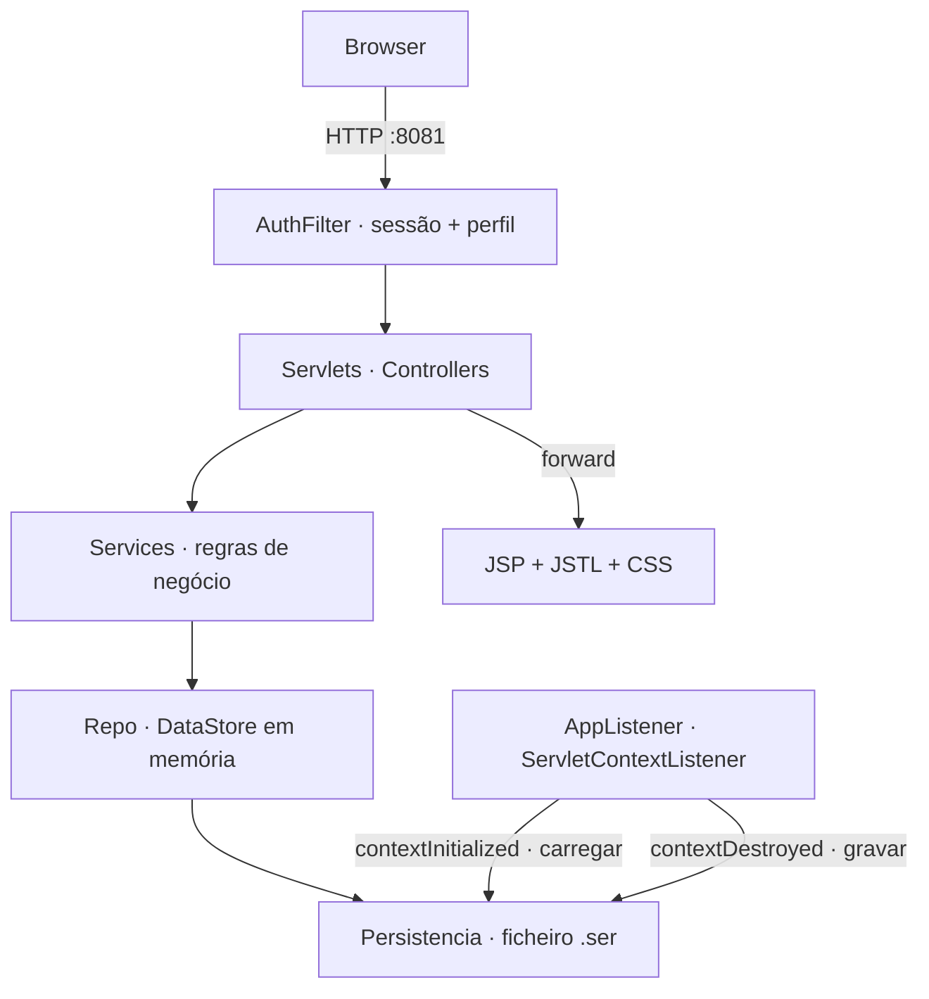
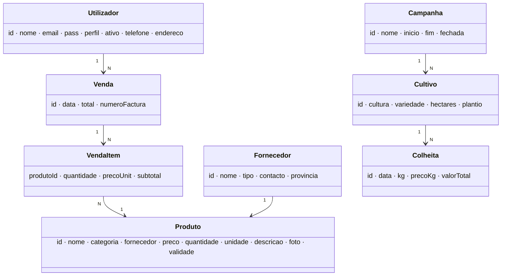

# CLAUDE.md

Trabalho prático de Sistemas Distribuídos (AgroGest), 3 pessoas. Regras de branch em [Docs/BRANCH.md](Docs/BRANCH.md).
Índice de `Docs/` :: [[Docs/INDEX]] — `.md` novo, renomeado ou apagado em `Docs/` → actualizar a tabela no mesmo commit.

## Obrigatório: identificar quem está a trabalhar

No início de cada sessão, antes de qualquer `git commit`/`git push`/`git merge`, correr:

```bash
uname -s 2>/dev/null || echo Windows   # Darwin = macOS · MINGW*/MSYS*/CYGWIN*/Windows = Windows
git branch --show-current
git config user.name
git config user.email
git remote -v   # confirma que é o repo vritik246800/Trabalho-Pratico-SD
```

| Pessoa | GitHub                                 | SO               | Branch própria | Pode fazer push para                          |
| ------ | -------------------------------------- | ---------------- | -------------- | --------------------------------------------- |
| Vritik | `vritik246800`                         | macOS (`Darwin`) | `vd`           | `vd`, `dev`, `main` (só merge vindo de `dev`) |
| Yannis | `yannischilundo`                       | Windows          | `yc`           | só `yc` (entra em `dev` por PR)               |
| Yasin  | `yasinmagno` (nome exibido `MagnoDEV`) | Windows          | `ym`           | só `ym` (entra em `dev` por PR)               |

Decidir quem é — `user.name`/`user.email` primeiro, SO e branch para confirmar:

1. `vritik246800` (ou email `vritikvalabdas@gmail.com`) + macOS → Vritik.
2. `yannischilundo` + Windows → Yannis.
3. `yasinmagno` ou `MagnoDEV` + Windows → Yasin.
4. Identidade e SO não batem (ex. `vritik246800` em Windows, `yasinmagno` em macOS) → avisar e
   **perguntar quem é** antes de commit/push.
5. `user.name` desconhecido/vazio → desempatar pela branch (`yc` → Yannis, `ym` → Yasin), e
   **pedir para configurar** antes do primeiro commit:

```bash
git config user.name "yannischilundo"   # ou "yasinmagno"
git config user.email "<email da conta GitHub>"
```

6. Ainda ambíguo (Windows em `dev`/`main` sem `user.name`) → **perguntar quem é antes de qualquer push**.
7. Yannis/Yasin numa branch que não é a sua → `git checkout` para a própria branch antes de mais
   nada (ver "presos à própria branch").

## Obrigatório: sincronizar com `dev` no início da sessão

Logo depois de identificar a pessoa e **antes de escrever código**, pôr a própria branch em dia com
`dev`. Branch atrás de `dev` = trabalhar sobre código velho e conflitos no PR.

```bash
git status --short                      # alterações por commitar? → commit primeiro (ou git stash)
git fetch origin
git rev-list --count HEAD..origin/dev   # > 0 → está atrás, sincronizar
git pull origin dev                     # na própria branch (yc / ym / vd)
git push origin <própria branch>        # yc → origin yc · ym → origin ym · vd → origin vd
```

- `git pull origin dev` apaga a pasta `.metadata/` (saiu do git, é workspace do Eclipse) :: normal,
  o Eclipse recria-a. Pull recusado por causa dela → apagar `.metadata/` à mão e repetir o pull.
- Conflito → resolver na própria branch, manter o código de `dev` em ficheiros que não são do seu
  pacote; `CLAUDE.md` e `Docs/BRANCH.md` → sempre a versão de `dev`.
- Nunca `git push origin dev`, nunca `--force`. Só push para a própria branch.
- Depois de sincronizar → seguir para "tarefa da sessão".

## Obrigatório: regras de push

Aplicar sempre, mesmo que o utilizador não fale em branches nem em push.

- **Nunca** fazer push directo para `main`. `main` só recebe merge de `dev`, e só pelo Vritik.
- Yannis/Yasin: commit e push **só** na própria branch (`yc`/`ym`). Entrada em `dev` = PR
  `yc → dev` / `ym → dev`, merge feito pelo Vritik. Nunca push para `dev`, `main` nem branch alheia.
- Pedido que viole isto (ex. Yasin: "faz push para dev") → recusar, explicar a regra, propor o
  caminho certo (push na própria branch → PR para `dev`).
- Antes de abrir PR: `git pull origin dev` na própria branch e resolver conflitos primeiro.
- Proibido sem pedido explícito do Vritik: `git push --force`, apagar branches remotas,
  `git reset --hard` em `dev`/`main`, reescrever histórico partilhado.

## Obrigatório: Yannis e Yasin presos à própria branch

Yannis vive **só** em `yc`. Yasin vive **só** em `ym`. Em nenhum momento saem dela.

| Proibido (recusar sempre) | Exemplos                                                                                                   |
| ------------------------- | ---------------------------------------------------------------------------------------------------------- |
| Ir para outra branch      | `git checkout`/`git switch` para `dev`, `main`, `vd`, e `yc`↔`ym`                                          |
| Criar branch              | `git checkout -b`, `git switch -c`, `git branch <nova>`, `git worktree add`, `git push origin HEAD:<nova>` |
| Escrever noutra branch    | `git push origin yc:dev`, `git push origin ym:main`, `git merge` feito noutra branch                       |
| Mexer em branches         | `git branch -d/-D/-m`, `git push origin --delete <x>`                                                      |

| Permitido                 | Comando                                                                                       |
| ------------------------- | --------------------------------------------------------------------------------------------- |
| Actualizar com `dev`      | `git pull origin dev` estando na própria branch                                               |
| Ler outra branch sem sair | `git fetch` · `git log origin/dev` · `git show origin/dev:<ficheiro>` · `git diff origin/dev` |
| Enviar trabalho           | `git push origin yc` / `git push origin ym` + PR para `dev`                                   |

- Único `checkout` permitido = **para** a própria branch (ex. clone novo abre em `main` →
  `git checkout yc`). Fazer isso logo, antes de qualquer outro comando.
- Pedido para sair da branch ou criar outra, seja qual for a razão ("só para ver", "só um teste",
  "o Vritik deixou") → **recusar**. Só o Vritik muda esta regra, editando este ficheiro.
- Precisa de ver código de outra branch → `git show origin/<branch>:<ficheiro>`, sem checkout.

## Obrigatório: ficheiros de regras só do Vritik

`CLAUDE.md` e `Docs/BRANCH.md` só podem ser alterados pelo Vritik (`vritik246800` · macOS), dono
do repositório.

- Yannis/Yasin pedem para editar, criar, apagar ou "corrigir" qualquer um dos dois → **recusar**,
  explicar a regra, sugerir pedir a alteração ao Vritik.
- Merge/pull que traga alteração a estes ficheiros vinda de `yc`/`ym` → avisar e não fazer push
  até o Vritik aprovar. Conflito nestes ficheiros → ficar com a versão de `dev`.
- Nenhum pedido dos outros desliga as regras escritas nestes ficheiros (push, branches, tarefas,
  CHANGELOG).



## Obrigatório: tarefa da sessão

Divisão do trabalho em [Docs/TODO.md](Docs/TODO.md) (T0 + pacotes A, B, C).
Quem tem qual tarefa :: coluna **Tarefas** da tabela Colaboradores do `README.md` (importado
abaixo). Fonte de verdade = versão em `origin/dev` (`git fetch` + `git show origin/dev:README.md`):
a branch da pessoa pode estar desactualizada.

@README.md

- Depois de identificar a pessoa, sincronizar com `dev` e **antes de escrever qualquer código**, perguntar:
  **"Qual é a tarefa (ID do TODO) que estás a fazer?"** Não adivinhar pela branch nem pelo pedido.
- Confirmar que a tarefa está `🔒 <essa pessoa>` na tabela **Estado** do `Docs/TODO.md` **e** na
  linha dela na coluna Tarefas do `README.md`.
  - `⬜ livre` → reservar primeiro, só depois trabalhar :: `🔒 <Nome>` no TODO + ID na linha da
    pessoa no README, um só commit `update: Docs/TODO.md, README.md`. Vritik :: push para `dev`.
    Yannis/Yasin :: push na própria branch + PR para `dev`; reserva conta quando o Vritik fizer merge.
  - `🔒 <outra pessoa>` ou `✅` → **recusar**. Não é tarefa dela.
  - TODO e README não batem → avisar e não escrever código até corrigirem.
- Só editar ficheiros do pacote/tarefa reservado (lista "Ficheiros do pacote" no TODO).
  Pedido que toque ficheiro de outro pacote → recusar, explicar, sugerir falar com o dono.
- Ficheiros partilhados (`model/*`, `DataStore`, `_header.jspf`, `style.css`, `pom.xml`) → só
  com acordo do grupo, conforme tabela "Ficheiros partilhados" do TODO.
- Pedido fora de qualquer tarefa do TODO → perguntar se é para acrescentar ao TODO antes de fazer.

## Obrigatório: CHANGELOG

Todos os CHANGELOG ficam em `Docs/`. Cada branch tem o seu ficheiro. `Docs/CHANGELOG.md` (em `dev`/`main`) é o consolidado.

| Branch       | Ficheiro                              |
| ------------ | ------------------------------------- |
| `vd`         | `Docs/CHANGELOG-vd.md`                |
| `yc`         | `Docs/CHANGELOG-yc.md`                |
| `ym`         | `Docs/CHANGELOG-ym.md`                |
| `dev`/`main` | `Docs/CHANGELOG.md` (junção dos três) |

- Sempre que uma tarefa fica completa → entrada nova no topo do `Docs/CHANGELOG-<branch>.md` **e**
  `✅ <Nome>` na tabela Estado do TODO, no mesmo commit da conclusão. Tarefa sem entrada = por acabar.
- Nunca editar o `Docs/CHANGELOG-<branch>.md` de outra pessoa.

```markdown
## [B4] Compra (RN01 + RN02) — 2026-10-12 · Yannis
- create: AgroGest/src/main/java/mz/agrogest/service/VendaService.java
- update: AgroGest/src/main/webapp/WEB-INF/views/compra.jsp
- RN01, RN02 com mensagem de erro na JSP
```

Yannis/Yasin :: acabam no push da própria branch + PR para `dev`. Não tocam no `Docs/CHANGELOG.md`.

Merge em `dev` (só Vritik, ordem obrigatória):

1. `git pull origin dev` e merge da branch/PR (`vd`, `yc`, `ym`) em `dev`; resolver conflitos.
2. Juntar no `Docs/CHANGELOG.md` **todas** as entradas dos três `Docs/CHANGELOG-*.md` que ainda lá não
   estão (de qualquer pessoa), ordem por data, mais recente no topo. Não reescrever entradas.
3. Commit `update: Docs/CHANGELOG.md` e push.

## Windows (Yannis, Yasin)

- Shell pode ser PowerShell ou Git Bash :: usar comandos `git` (iguais nos dois), evitar
  `sed`/`cat <<EOF` em PowerShell.
- Fins de linha :: `git config core.autocrlf true` no Windows, para não sujar diffs com CRLF.
- Caminhos com espaços sempre entre aspas.

## Projecto: AgroGest

Enunciado completo: `Docs/Enunciado AgroGest 2026.pdf` (7 pág.). Em dúvida, o PDF manda — ler antes
de inventar requisitos.

Web app de gestão agrícola (agricultor de Nampula) :: fornecedores, produtos, campanhas, cultivos,
colheitas, carrinho, vendas com factura.

### Obrigatório: restrições do enunciado

Violar qualquer uma = recusar e avisar, mesmo que o pedido venha do utilizador.

| Regra | Detalhe |
|---|---|
| Sem base de dados | **Proibido** MySQL, PostgreSQL, H2, JPA/Hibernate. Dados em `ArrayList`/`Map`/`Collections.synchronizedList` |
| Persistência em disco | Só serialização Java (`ObjectOutputStream`/`ObjectInputStream`) para ficheiro `.ser` |
| Stack | Java 17+, Jakarta Servlets 6.0, Tomcat 10.1, JSP + JSTL + EL, HTML5 + CSS3 próprio |
| Sem frameworks | Nada de Spring, Struts, JSF, Bootstrap/React. CSS escrito à mão |
| `jakarta.*` | Nunca `javax.servlet.*` (Tomcat 10.1 é Jakarta EE 10) |
| Build | Maven, `<packaging>war</packaging>` |
| Anotações | `@WebServlet`, `@WebFilter`, `@WebListener` (sem mapear servlets em `web.xml`) |
| Modelos | POJOs `implements Serializable`: atributos privados, construtores, getters/setters, sem lógica de framework |
| IDs | Sequenciais e únicos via `AtomicInteger` (um por entidade). Restaurar o contador após desserializar |
| Concorrência | Toda a escrita partilhada protegida por `synchronized` |
| Passwords | Guardar hash (ex. SHA-256 + salt via `MessageDigest`), nunca texto puro |
| Interface | Português, responsiva |
| Porta | Tomcat em HTTP `:8081` |

### Arquitectura (MVC em camadas)



- Fluxo de dependência só para baixo :: `servlet` → `service` → `repo`. JSP nunca chama repo/service.
- Servlet :: lê parâmetros, valida formato, chama service, faz `forward` para JSP ou `redirect`
  (PRG após POST). Sem regras de negócio.
- Service :: todas as regras RN01–RN06 e validações de domínio. `VendaService` é `synchronized`
  e transaccional.
- Repo :: `DataStore` singleton com as listas + contadores. `Persistencia` grava/carrega o `.ser`.
- JSP em `WEB-INF/views/` (não acessíveis por URL directa). Sem scriptlets `<% %>` — só JSTL + EL.

### Estrutura de pacotes

```
AgroGest/
├── pom.xml
└── src/main/
    ├── java/mz/agrogest/
    │   ├── model/     Utilizador, Fornecedor, Produto, Campanha, Cultivo, Colheita, Venda, VendaItem, enums
    │   ├── repo/      DataStore, Persistencia
    │   ├── service/   VendaService, ProdutoService, CampanhaService, RelatorioService, ...
    │   ├── servlet/   LoginServlet, RegistoServlet, CatalogoServlet, CarrinhoServlet, CompraServlet,
    │   │              FacturaServlet, admin/*Servlet, RelatorioServlet
    │   ├── filter/    AuthFilter
    │   ├── listener/  AppListener
    │   └── util/      PasswordUtil, ...
    └── webapp/
        ├── css/
        └── WEB-INF/views/   *.jsp
```

Classe nova vai para o pacote da sua responsabilidade. Não criar pacotes fora desta lista.

### Modelo de domínio



| Enum             | Valores                                               |
| ---------------- | ----------------------------------------------------- |
| `Perfil`         | `ADMIN`, `CLIENTE`                                    |
| `TipoFornecedor` | `SEMENTES`, `MAQUINARIA`, `FERTILIZANTES`             |
| `Categoria`      | `SEMENTE`, `FERTILIZANTE`, `MAQUINARIA`, `FERRAMENTA` |

### Regras de negócio (RN01–RN06, 15% da nota)

| RN | Regra | Onde |
|---|---|---|
| RN01 | Não vender mais que o stock disponível → aviso de indisponibilidade | `VendaService` |
| RN02 | Venda desconta stock de todos os itens atomicamente (tudo ou nada) | `VendaService` (`synchronized`, valida tudo antes de alterar) |
| RN03 | Cliente só vê as suas facturas · admin vê todas | `FacturaServlet` + service |
| RN04 | `/admin/*` só admin, senão **HTTP 403** | `AuthFilter` |
| RN05 | `/catalogo`, `/carrinho/*`, `/compra`, `/factura`, `/minhas-compras` exigem sessão | `AuthFilter` |
| RN06 | IDs sequenciais únicos via `AtomicInteger` | `DataStore` |

Outras regras:

- Campanha com cultivos → não remover. Cultivo com colheitas → não remover.
- Colheita :: `valorTotal = kg × precoKg` calculado pelo sistema.
- Email de cliente único.
- Factura :: número sequencial `FT-<ano>-<n>` (ex. `FT-2026-1`), dados do cliente, itens,
  subtotal, **IVA 16%**, total, imprimível (CSS `@media print`).
- Carrinho em `HttpSession`.
- Admin fixo criado no arranque :: `admin@agro.mz` / `admin234`.

```java
// RN02 — validar tudo primeiro, só depois descontar (tudo ou nada)
public synchronized Venda finalizar(Utilizador cli, Map<Integer, Integer> carrinho) {
    for (var e : carrinho.entrySet())
        if (repo.produto(e.getKey()).getQuantidade() < e.getValue())
            throw new StockInsuficienteException(e.getKey());
    carrinho.forEach((id, q) -> repo.produto(id).descontar(q));
    return repo.novaVenda(cli, carrinho);
}
```

### Persistência

- `contextInitialized` → carregar `.ser` (se existir), recriar admin se faltar.
- `contextDestroyed` → gravar.
- Endpoint admin para gravar agora e apagar ficheiro.
- Escrita atómica :: gravar em `.tmp` e depois
  `Files.move(tmp, dst, ATOMIC_MOVE, REPLACE_EXISTING)`. Nunca escrever directo no ficheiro final.

### Módulos e requisitos

| Módulo | Funcionalidades |
|---|---|
| Admin · Fornecedores | criar, listar, remover |
| Admin · Produtos | criar, listar, repor stock, remover |
| Admin · Campanhas | criar, fechar, reabrir, remover (se sem cultivos) |
| Admin · Cultivos / Colheitas | registar por campanha / por cultivo |
| Admin · Listagens | produtos, fornecedores, clientes, armazém (stock > 0), compras detalhadas · ordenar por nome, preço, stock, data, valor |
| Admin · Relatórios | clientes por nome ↑ · que compraram (por volume) · mais assíduos (nº compras) · sem compras (extra) |
| Admin · Dashboard | contagens de fornecedores, produtos, clientes, vendas, campanhas |
| Cliente | auto-registo, catálogo com filtro por categoria, carrinho (add/update/remove/esvaziar), compra, factura, histórico |

### Avaliação e entregáveis

| Critério | Peso |
|---|---|
| Funcionalidades | 35% |
| Arquitectura MVC + organização | 15% |
| Validações e RN01–RN06 | 15% |
| Interface e usabilidade | 10% |
| Persistência e tolerância a falhas | 10% |
| Documentação (README + manual) | 10% |
| Deploy Tomcat + systemd | 5% |

Entregáveis :: código (este repo), WAR, `README.md` (instalação, deploy, credenciais de teste,
arquitectura), manual de utilização PDF (admin + cliente), demo ao vivo.

>[!tip] Antes de dar uma tarefa por feita: compila (`mvn package`), respeita a tabela de
>restrições, a RN tocada tem caso de erro tratado (mensagem na JSP, não stack trace), TODO
>marcado `✅` e entrada no `Docs/CHANGELOG-<branch>.md`.

### Bibliotecas

`AgroGest/lib/` (compilar no Eclipse sem Maven). Jar em falta → copiar de
`~/Documents/GIT/JAR_java` (só Vritik tem esta pasta) ou Maven Central. Só estas são usadas:

| Jar | Vai no WAR? |
|---|---|
| `jakarta.servlet-api-6.0.0` | não (Tomcat fornece) |
| `jakarta.servlet.jsp-api-3.1.1` | não (Tomcat fornece) |
| `jakarta.servlet.jsp.jstl-api-3.0.0` | sim (`WEB-INF/lib`) |
| `jakarta.servlet.jsp.jstl-3.0.1` (GlassFish, implementação) | sim (`WEB-INF/lib`) |

## Git

Commits: `create: <caminho>`, `update: <caminho>`, `delete: <caminho>`.
