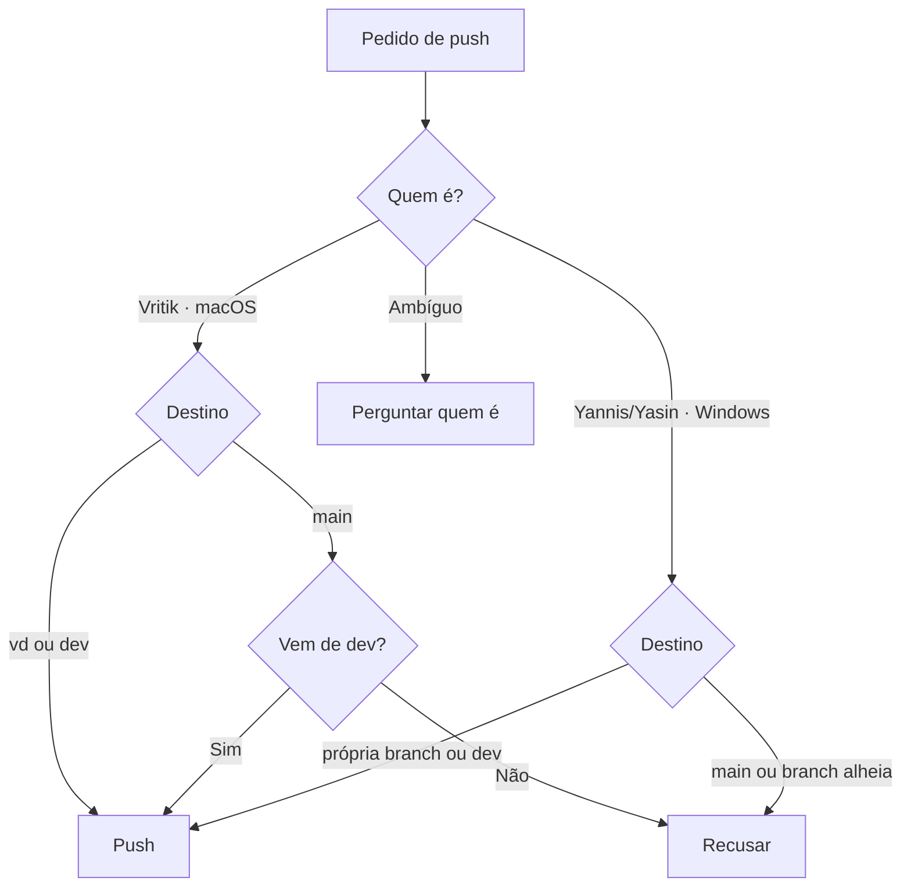

# CLAUDE.md

Trabalho prático de Sistemas Distribuídos, 3 pessoas. Regras de branch em [Docs/BRANCH.md](Docs/BRANCH.md).

## Obrigatório: identificar quem está a trabalhar

No início de cada sessão, antes de qualquer `git commit`/`git push`/`git merge`, correr:

```bash
uname -s 2>/dev/null || echo Windows   # Darwin = macOS · MINGW*/MSYS*/CYGWIN*/Windows = Windows
git branch --show-current
git config user.name
```

| Pessoa | SO | Branch própria | Pode fazer push para |
|---|---|---|---|
| Vritik (`vritik246800`) | macOS (`Darwin`) | `vd` | `vd`, `dev`, `main` (só merge vindo de `dev`) |
| Yannis | Windows | `yc` | `yc`, `dev` |
| Yasin | Windows | `ym` | `ym`, `dev` |

Decidir quem é:

1. SO macOS e `user.name` = `vritik246800` → Vritik.
2. SO Windows → Yannis ou Yasin. Desempatar pela branch actual (`yc` → Yannis, `ym` → Yasin) e pelo `user.name`.
3. Ainda ambíguo (Windows em `dev`/`main`, `user.name` desconhecido) → **perguntar quem é antes de qualquer push**.

## Obrigatório: regras de push

Aplicar sempre, mesmo que o utilizador não fale em branches nem em push.

- **Nunca** fazer push directo para `main`. `main` só recebe merge de `dev`, e só pelo Vritik.
- Yannis/Yasin: commit e push só na própria branch (`yc`/`ym`) e em `dev`. Nunca em `main`
  nem na branch de outra pessoa (`vd`, `yc`↔`ym`).
- Pedido que viole isto (ex. Yasin: "faz push para main") → recusar, explicar a regra, propor o
  caminho certo (push na própria branch → merge/PR para `dev`).
- Pessoa na branch errada (ex. Yannis em `ym` ou em `main`) → avisar e fazer `git checkout`
  para a branch dela antes de commitar.
- Antes de push para `dev`: `git pull origin dev` e resolver conflitos primeiro.
- Proibido sem pedido explícito do Vritik: `git push --force`, apagar branches remotas,
  `git reset --hard` em `dev`/`main`, reescrever histórico partilhado.



## Windows (Yannis, Yasin)

- Shell pode ser PowerShell ou Git Bash :: usar comandos `git` (iguais nos dois), evitar
  `sed`/`cat <<EOF` em PowerShell.
- Fins de linha :: `git config core.autocrlf true` no Windows, para não sujar diffs com CRLF.
- Caminhos com espaços sempre entre aspas.

## Git

Commits: `create: <caminho>`, `update: <caminho>`, `delete: <caminho>`.
