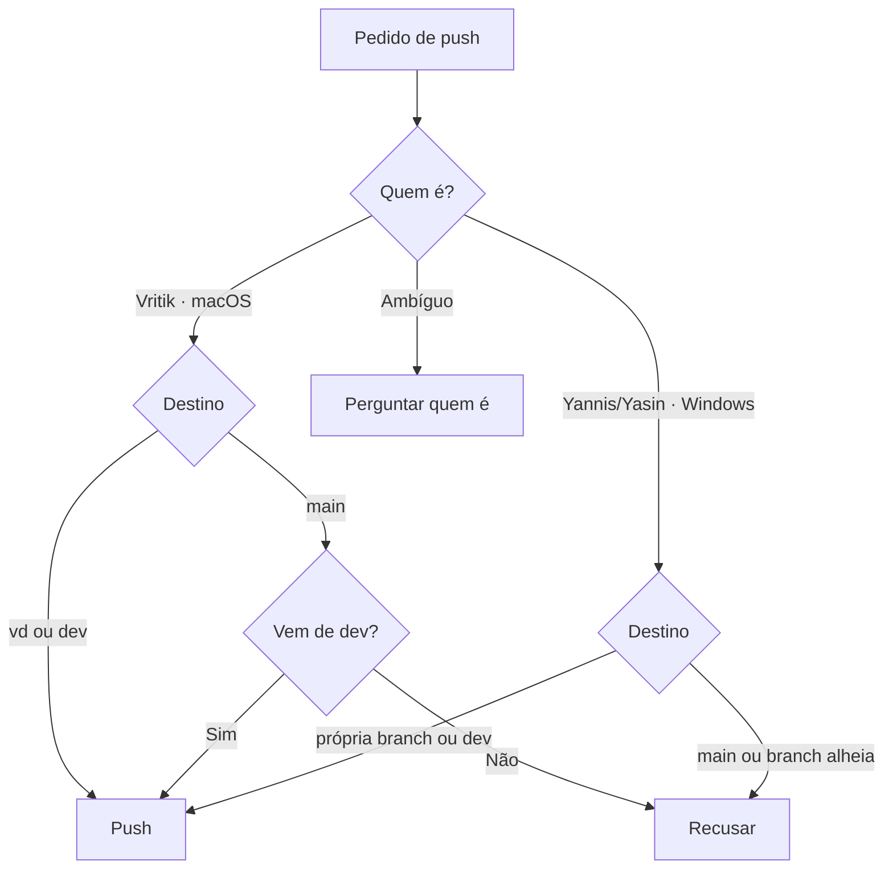
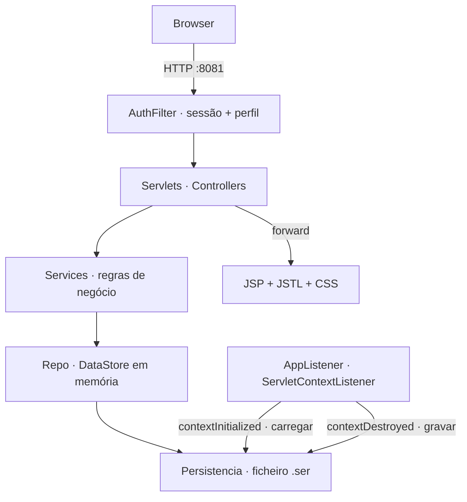
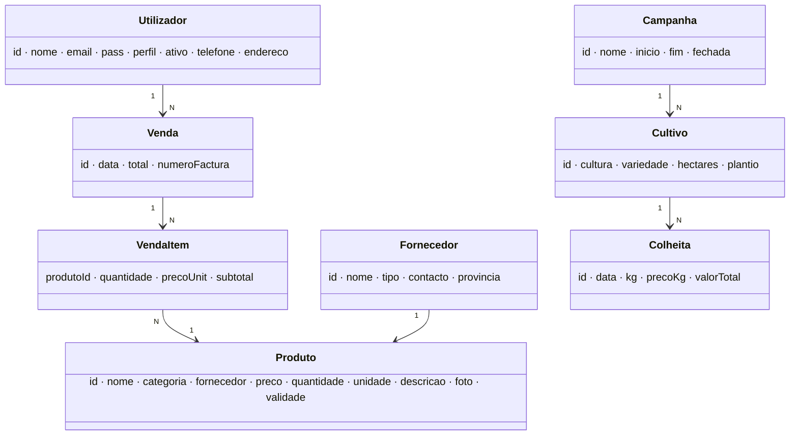

# CLAUDE.md

Trabalho prático de Sistemas Distribuídos (AgroGest), 3 pessoas. Regras de branch em [Docs/BRANCH.md](Docs/BRANCH.md).

## Obrigatório: identificar quem está a trabalhar

No início de cada sessão, antes de qualquer `git commit`/`git push`/`git merge`, correr:

```bash
uname -s 2>/dev/null || echo Windows   # Darwin = macOS · MINGW*/MSYS*/CYGWIN*/Windows = Windows
git branch --show-current
git config user.name
```

| Pessoa | SO | Branch própria | Pode fazer push para |
|---|---|---|---|
| Vritik (`vritik246800`) | macOS (`Darwin`) | `vd` | `vd`, `dev`, `main` (só merge vindo de `dev`) |
| Yannis | Windows | `yc` | `yc`, `dev` |
| Yasin | Windows | `ym` | `ym`, `dev` |

Decidir quem é:

1. SO macOS e `user.name` = `vritik246800` → Vritik.
2. SO Windows → Yannis ou Yasin. Desempatar pela branch actual (`yc` → Yannis, `ym` → Yasin) e pelo `user.name`.
3. Ainda ambíguo (Windows em `dev`/`main`, `user.name` desconhecido) → **perguntar quem é antes de qualquer push**.

## Obrigatório: regras de push

Aplicar sempre, mesmo que o utilizador não fale em branches nem em push.

- **Nunca** fazer push directo para `main`. `main` só recebe merge de `dev`, e só pelo Vritik.
- Yannis/Yasin: commit e push só na própria branch (`yc`/`ym`) e em `dev`. Nunca em `main`
  nem na branch de outra pessoa (`vd`, `yc`↔`ym`).
- Pedido que viole isto (ex. Yasin: "faz push para main") → recusar, explicar a regra, propor o
  caminho certo (push na própria branch → merge/PR para `dev`).
- Pessoa na branch errada (ex. Yannis em `ym` ou em `main`) → avisar e fazer `git checkout`
  para a branch dela antes de commitar.
- Antes de push para `dev`: `git pull origin dev` e resolver conflitos primeiro.
- Proibido sem pedido explícito do Vritik: `git push --force`, apagar branches remotas,
  `git reset --hard` em `dev`/`main`, reescrever histórico partilhado.



## Windows (Yannis, Yasin)

- Shell pode ser PowerShell ou Git Bash :: usar comandos `git` (iguais nos dois), evitar
  `sed`/`cat <<EOF` em PowerShell.
- Fins de linha :: `git config core.autocrlf true` no Windows, para não sujar diffs com CRLF.
- Caminhos com espaços sempre entre aspas.

## Projecto: AgroGest

Enunciado completo: `Docs/Enunciado AgroGest 2026.pdf` (7 pág.). Em dúvida, o PDF manda — ler antes
de inventar requisitos.

Web app de gestão agrícola (agricultor de Nampula) :: fornecedores, produtos, campanhas, cultivos,
colheitas, carrinho, vendas com factura.

### Obrigatório: restrições do enunciado

Violar qualquer uma = recusar e avisar, mesmo que o pedido venha do utilizador.

| Regra | Detalhe |
|---|---|
| Sem base de dados | **Proibido** MySQL, PostgreSQL, H2, JPA/Hibernate. Dados em `ArrayList`/`Map`/`Collections.synchronizedList` |
| Persistência em disco | Só serialização Java (`ObjectOutputStream`/`ObjectInputStream`) para ficheiro `.ser` |
| Stack | Java 17+, Jakarta Servlets 6.0, Tomcat 10.1, JSP + JSTL + EL, HTML5 + CSS3 próprio |
| Sem frameworks | Nada de Spring, Struts, JSF, Bootstrap/React. CSS escrito à mão |
| `jakarta.*` | Nunca `javax.servlet.*` (Tomcat 10.1 é Jakarta EE 10) |
| Build | Maven, `<packaging>war</packaging>` |
| Anotações | `@WebServlet`, `@WebFilter`, `@WebListener` (sem mapear servlets em `web.xml`) |
| Modelos | POJOs `implements Serializable`: atributos privados, construtores, getters/setters, sem lógica de framework |
| IDs | Sequenciais e únicos via `AtomicInteger` (um por entidade). Restaurar o contador após desserializar |
| Concorrência | Toda a escrita partilhada protegida por `synchronized` |
| Passwords | Guardar hash (ex. SHA-256 + salt via `MessageDigest`), nunca texto puro |
| Interface | Português, responsiva |
| Porta | Tomcat em HTTP `:8081` |

### Arquitectura (MVC em camadas)



- Fluxo de dependência só para baixo :: `servlet` → `service` → `repo`. JSP nunca chama repo/service.
- Servlet :: lê parâmetros, valida formato, chama service, faz `forward` para JSP ou `redirect`
  (PRG após POST). Sem regras de negócio.
- Service :: todas as regras RN01–RN06 e validações de domínio. `VendaService` é `synchronized`
  e transaccional.
- Repo :: `DataStore` singleton com as listas + contadores. `Persistencia` grava/carrega o `.ser`.
- JSP em `WEB-INF/views/` (não acessíveis por URL directa). Sem scriptlets `<% %>` — só JSTL + EL.

### Estrutura de pacotes

```
AgroGest/
├── pom.xml
└── src/main/
    ├── java/mz/agrogest/
    │   ├── model/     Utilizador, Fornecedor, Produto, Campanha, Cultivo, Colheita, Venda, VendaItem, enums
    │   ├── repo/      DataStore, Persistencia
    │   ├── service/   VendaService, ProdutoService, CampanhaService, RelatorioService, ...
    │   ├── servlet/   LoginServlet, RegistoServlet, CatalogoServlet, CarrinhoServlet, CompraServlet,
    │   │              FacturaServlet, admin/*Servlet, RelatorioServlet
    │   ├── filter/    AuthFilter
    │   ├── listener/  AppListener
    │   └── util/      PasswordUtil, ...
    └── webapp/
        ├── css/
        └── WEB-INF/views/   *.jsp
```

Classe nova vai para o pacote da sua responsabilidade. Não criar pacotes fora desta lista.

### Modelo de domínio



| Enum | Valores |
|---|---|
| `Perfil` | `ADMIN`, `CLIENTE` |
| `TipoFornecedor` | `SEMENTES`, `MAQUINARIA`, `FERTILIZANTES` |
| `Categoria` | `SEMENTE`, `FERTILIZANTE`, `MAQUINARIA`, `FERRAMENTA` |

### Regras de negócio (RN01–RN06, 15% da nota)

| RN | Regra | Onde |
|---|---|---|
| RN01 | Não vender mais que o stock disponível → aviso de indisponibilidade | `VendaService` |
| RN02 | Venda desconta stock de todos os itens atomicamente (tudo ou nada) | `VendaService` (`synchronized`, valida tudo antes de alterar) |
| RN03 | Cliente só vê as suas facturas · admin vê todas | `FacturaServlet` + service |
| RN04 | `/admin/*` só admin, senão **HTTP 403** | `AuthFilter` |
| RN05 | `/catalogo`, `/carrinho/*`, `/compra`, `/factura`, `/minhas-compras` exigem sessão | `AuthFilter` |
| RN06 | IDs sequenciais únicos via `AtomicInteger` | `DataStore` |

Outras regras:

- Campanha com cultivos → não remover. Cultivo com colheitas → não remover.
- Colheita :: `valorTotal = kg × precoKg` calculado pelo sistema.
- Email de cliente único.
- Factura :: número sequencial `FT-<ano>-<n>` (ex. `FT-2026-1`), dados do cliente, itens,
  subtotal, **IVA 16%**, total, imprimível (CSS `@media print`).
- Carrinho em `HttpSession`.
- Admin fixo criado no arranque :: `admin@agro.mz` / `admin234`.

```java
// RN02 — validar tudo primeiro, só depois descontar (tudo ou nada)
public synchronized Venda finalizar(Utilizador cli, Map<Integer, Integer> carrinho) {
    for (var e : carrinho.entrySet())
        if (repo.produto(e.getKey()).getQuantidade() < e.getValue())
            throw new StockInsuficienteException(e.getKey());
    carrinho.forEach((id, q) -> repo.produto(id).descontar(q));
    return repo.novaVenda(cli, carrinho);
}
```

### Persistência

- `contextInitialized` → carregar `.ser` (se existir), recriar admin se faltar.
- `contextDestroyed` → gravar.
- Endpoint admin para gravar agora e apagar ficheiro.
- Escrita atómica :: gravar em `.tmp` e depois
  `Files.move(tmp, dst, ATOMIC_MOVE, REPLACE_EXISTING)`. Nunca escrever directo no ficheiro final.

### Módulos e requisitos

| Módulo | Funcionalidades |
|---|---|
| Admin · Fornecedores | criar, listar, remover |
| Admin · Produtos | criar, listar, repor stock, remover |
| Admin · Campanhas | criar, fechar, reabrir, remover (se sem cultivos) |
| Admin · Cultivos / Colheitas | registar por campanha / por cultivo |
| Admin · Listagens | produtos, fornecedores, clientes, armazém (stock > 0), compras detalhadas · ordenar por nome, preço, stock, data, valor |
| Admin · Relatórios | clientes por nome ↑ · que compraram (por volume) · mais assíduos (nº compras) · sem compras (extra) |
| Admin · Dashboard | contagens de fornecedores, produtos, clientes, vendas, campanhas |
| Cliente | auto-registo, catálogo com filtro por categoria, carrinho (add/update/remove/esvaziar), compra, factura, histórico |

### Avaliação e entregáveis

| Critério | Peso |
|---|---|
| Funcionalidades | 35% |
| Arquitectura MVC + organização | 15% |
| Validações e RN01–RN06 | 15% |
| Interface e usabilidade | 10% |
| Persistência e tolerância a falhas | 10% |
| Documentação (README + manual) | 10% |
| Deploy Tomcat + systemd | 5% |

Entregáveis :: código (este repo), WAR, `README.md` (instalação, deploy, credenciais de teste,
arquitectura), manual de utilização PDF (admin + cliente), demo ao vivo.

>[!tip] Antes de dar uma tarefa por feita: compila (`mvn package`), respeita a tabela de
>restrições, e a RN tocada tem caso de erro tratado (mensagem na JSP, não stack trace).

## Git

Commits: `create: <caminho>`, `update: <caminho>`, `delete: <caminho>`.
