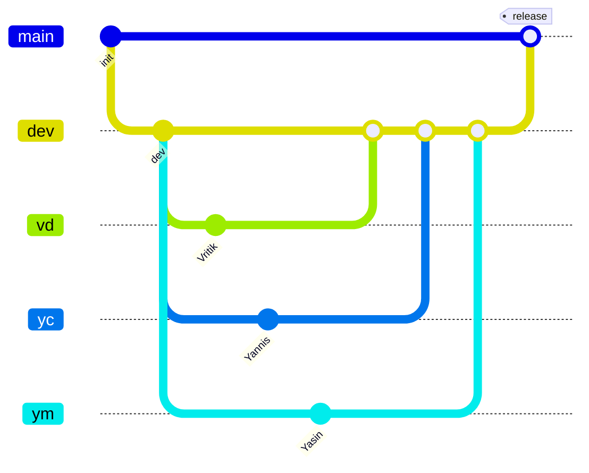

# Branches

| Branch | Dono | Origem | Merge para |
|---|---|---|---|
| `main` | Vritik | — | — |
| `dev` | todos | `main` | `main` (só Vritik) |
| `vd` | Vritik | `dev` | `dev` |
| `yc` | Yannis | `dev` | `dev` |
| `ym` | Yasin | `dev` | `dev` |



## Regras

- Ninguém faz push directo para `main`.
- `main` só recebe PR com origem `dev` (workflow `main-only-from-dev`).
- PR `dev` → `main` só merge pelo Vritik (`CODEOWNERS` + ruleset).
- Yannis/Yasin: push só na própria branch (`yc`/`ym`) e em `dev`. Nunca `main`.
- `CLAUDE.md` e `Docs/BRANCH.md` só o Vritik altera. Mudança vinda de `yc`/`ym` não entra em `dev`.

```bash
git checkout dev && git pull
git checkout yc && git merge dev   # actualizar a tua branch
git push origin yc                 # depois abrir PR yc -> dev
```
