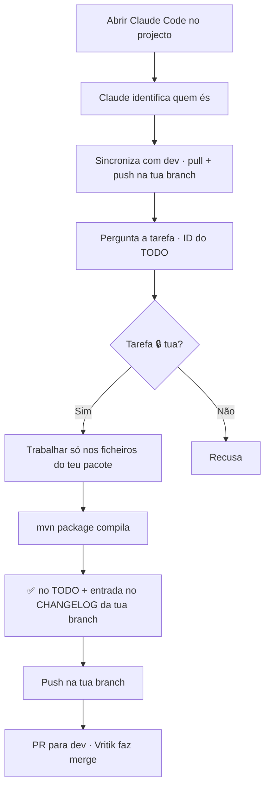

# Instruções — Yannis e Yasin

Como pôr a tua branch em dia e trabalhar no AgroGest sem partir nada. Regras completas em
[[BRANCH]] e no `CLAUDE.md`.

| Pessoa | Branch | Push para |
|---|---|---|
| Yannis (`yannischilundo`) | `yc` | só `origin yc` |
| Yasin (`yasinmagno`) | `ym` | só `origin ym` |

## 1. Uma vez só (agora)

A tua branch está atrás de `dev`, e o `CLAUDE.md` dela ainda é o antigo. Actualiza à mão uma vez;
depois o Claude faz sozinho.

```bash
git checkout yc                 # Yasin: ym
git status --short              # alterações? → git add . && git commit -m "update: ..."
git pull origin dev
git push origin yc              # Yasin: ym
```

Ou no Claude Code :: **"faz git pull origin dev na minha branch e depois push para a minha branch"**.

| Problema | Solução |
|---|---|
| Pull queixa-se de `.metadata/` | apagar a pasta `.metadata/` (é do Eclipse, ele recria) e repetir o pull |
| Conflito em `CLAUDE.md` ou `Docs/BRANCH.md` | ficar com a versão de `dev` :: `git checkout --theirs <ficheiro>` |
| Conflito noutro ficheiro | manter o teu código no teu pacote, o de `dev` no resto · em dúvida, falar com o Vritik |
| `Please tell me who you are` | `git config user.name "yannischilundo"` (ou `"yasinmagno"`) + `git config user.email "<email GitHub>"` |

## 2. Em cada sessão



- Claude não sincronizou sozinho → pedir :: **"sincroniza a minha branch com dev"**.
- Tarefa acabada :: `✅ <Nome>` no `Docs/TODO.md` **e** entrada nova no `Docs/CHANGELOG-yc.md` / `Docs/CHANGELOG-ym.md`, no mesmo commit.
- PR :: GitHub → **Pull requests** → **New** → base `dev` ← compare `yc`/`ym`.

## 3. Proibido

| Não fazer | Fazer em vez disso |
|---|---|
| `git push origin dev` / `main` | push na tua branch + PR para `dev` |
| `git checkout dev`, `main`, `vd` ou a branch do colega | `git show origin/dev:<ficheiro>` para ver sem sair |
| Criar branch nova | trabalhar só em `yc`/`ym` |
| `git push --force` | pedir ajuda ao Vritik |
| Editar `CLAUDE.md` ou `Docs/BRANCH.md` | pedir a alteração ao Vritik |
| Editar `Docs/CHANGELOG.md` ou o CHANGELOG do colega | só o teu `CHANGELOG-yc/ym.md` |
| Tocar em ficheiros de outro pacote ou partilhados (`model/*`, `DataStore`, `pom.xml`, `style.css`) | combinar com o grupo primeiro |
| Commitar `.ser`, passwords, tokens | ver [SECURITY.md](../SECURITY.md) |

## 4. Windows

- `git config core.autocrlf true` :: uma vez, evita diffs sujos com CRLF.
- Caminhos com espaços sempre entre aspas.
- PowerShell ou Git Bash :: comandos `git` são iguais nos dois.
