# Manual de utilização — AgroGest

Sistema de gestão agrícola para um agricultor de Nampula. Dois perfis :: **Administrador** (gere
catálogo, produção, vendas e dados) e **Cliente** (compra produtos e recebe factura).
Imagens em `Docs/img/manual/`.

## 1. O sistema

| Item | Valor |
|---|---|
| Endereço | `http://localhost:8081/agrogest/` |
| Servidor | Apache Tomcat 10.1, porta 8081 |
| Dados | em memória, gravados em `agrogest.ser` ao parar o Tomcat (ou à mão em Persistência) |
| Moeda | Metical (MT) · preços sem IVA, IVA 16 % somado no carrinho e na factura |
| Admin | `admin@agro.mz` / `admin234` |
| Clientes de teste | `joao@teste.mz`, `maria@teste.mz`, `carlos@teste.mz`, `ana@teste.mz`, `pedro@teste.mz` / `1234` |

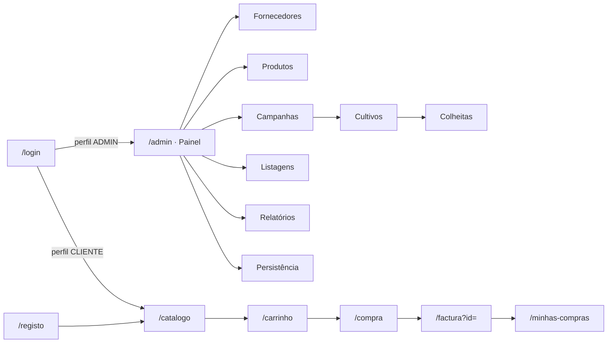

| Regra | O que o utilizador vê |
|---|---|
| RN01 | quantidade acima do stock → aviso, item não entra / compra bloqueada |
| RN02 | compra desconta stock de todos os itens de uma vez, ou de nenhum |
| RN03 | cliente só abre as suas facturas · admin abre todas |
| RN04 | cliente em `/admin/*` → página **403** |
| RN05 | catálogo, carrinho, compra, factura, histórico sem sessão → volta ao login |
| RN06 | IDs e números de factura sequenciais (`FT-2026-1`, `FT-2026-2`, …) |

Layout comum :: barra lateral à esquerda (grupos Catálogo, Produção, Vendas, Sistema no admin),
botão ☰ no topo recolhe a barra para ícones (ecrã largo) ou abre-a em gaveta (telemóvel).
Mensagens de sucesso aparecem como aviso no canto inferior direito.

## 2. Entrar e registar

### Login

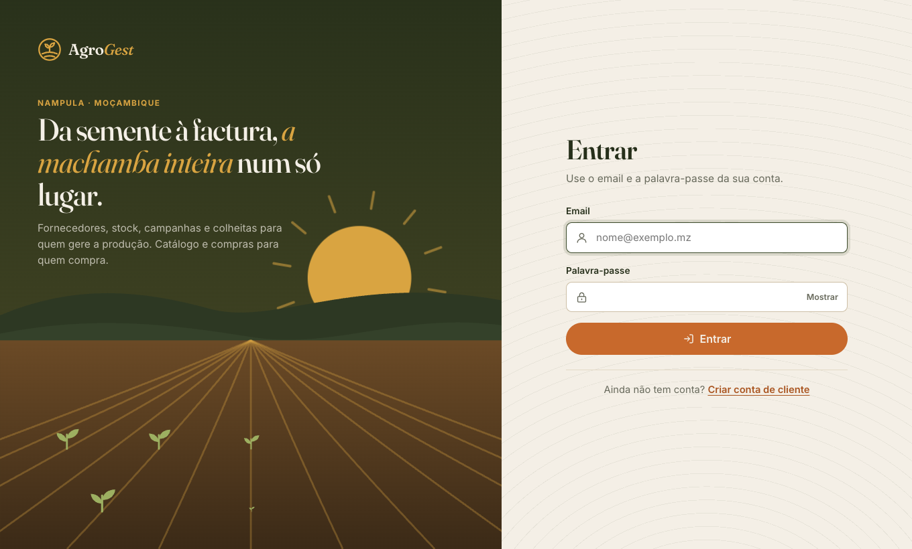

1. Abrir `http://localhost:8081/agrogest/`.
2. Email + palavra-passe → **Entrar**.
3. Admin vai para o Painel · cliente vai para o Catálogo.
- Sair :: **Sair** no fundo da barra lateral.

### Auto-registo (cliente)

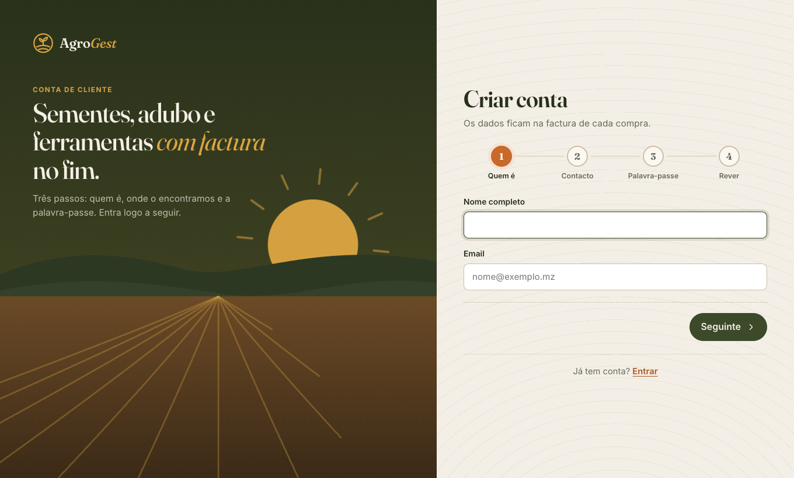

1. No login → **Criar conta de cliente**.
2. Assistente por passos :: **Quem é** (nome, email) → **Contacto** (telefone, endereço) → **Palavra-passe** → **Rever** → confirmar.
3. Conta criada entra logo no catálogo.
- Email já usado → erro no formulário (email único).
- Palavra-passe guardada só como hash SHA-256 + salt.

## 3. Administrador

### Painel

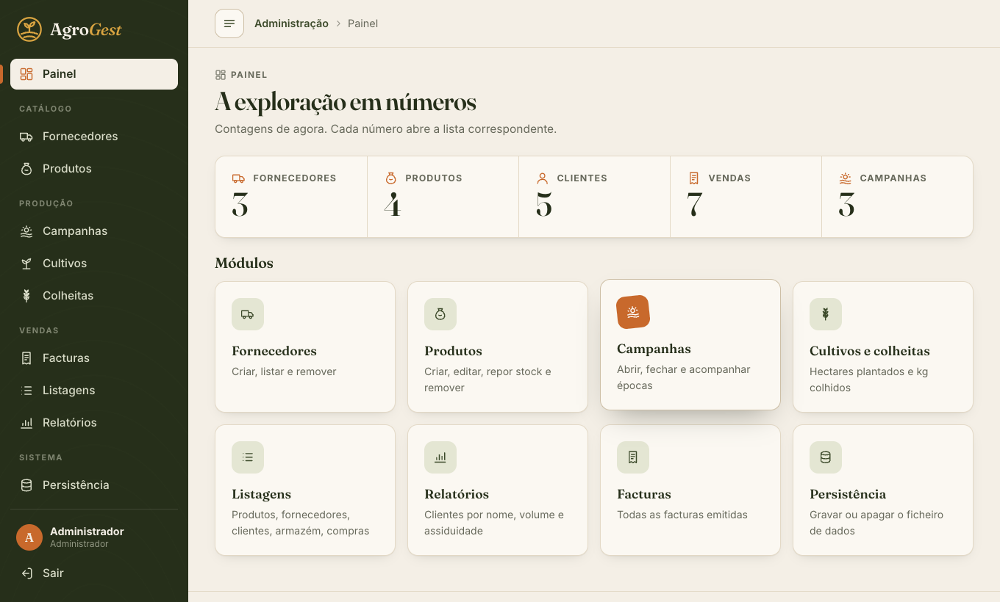

- Contagens :: fornecedores, produtos, clientes, vendas, campanhas · cada número abre a lista.
- Cartões de módulo :: atalhos para cada secção.
- Produtos fora da validade → alerta no topo do painel.

### Fornecedores

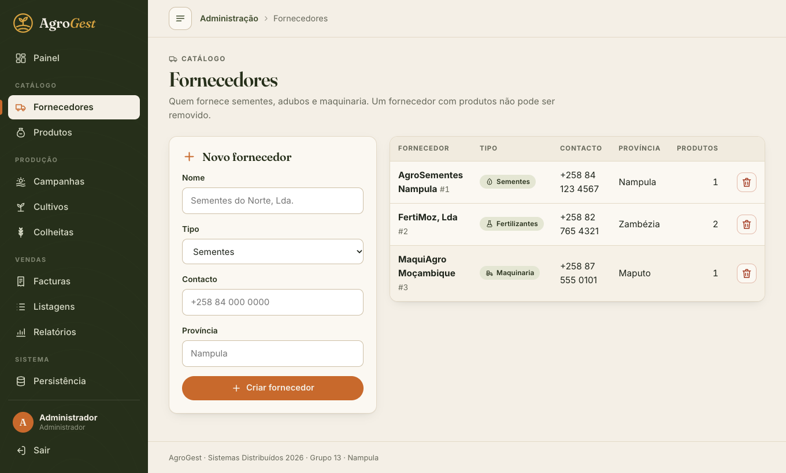

1. **Fornecedores** na barra lateral.
2. Preencher nome, tipo (`Sementes`, `Maquinaria`, `Fertilizantes`), contacto, província → **Criar fornecedor**.
3. Remover :: ícone do caixote na linha.
- Fornecedor com produtos não pode ser removido (mensagem de erro).

### Produtos

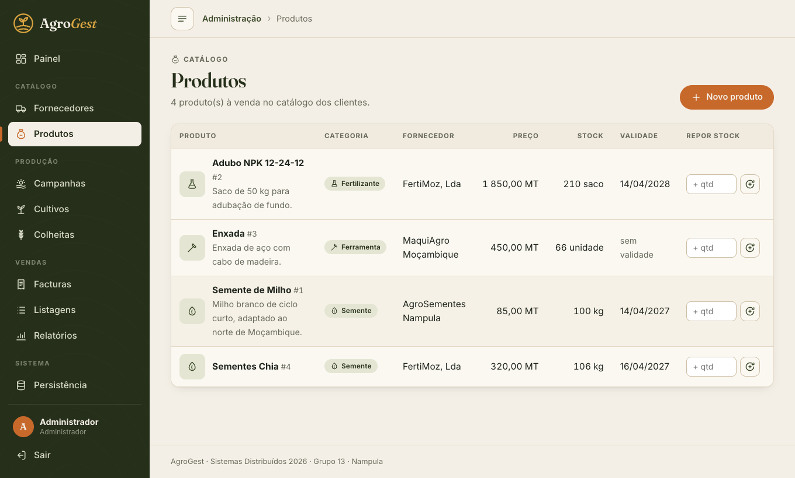

| Acção | Como |
|---|---|
| Criar | **Novo produto** → assistente de 4 passos (ver abaixo) |
| Editar | ícone de editar na linha → mesmo assistente com os dados preenchidos |
| Repor stock | campo de quantidade na linha + ícone ↻ (soma ao stock actual) |
| Remover | ícone do caixote → confirmar |

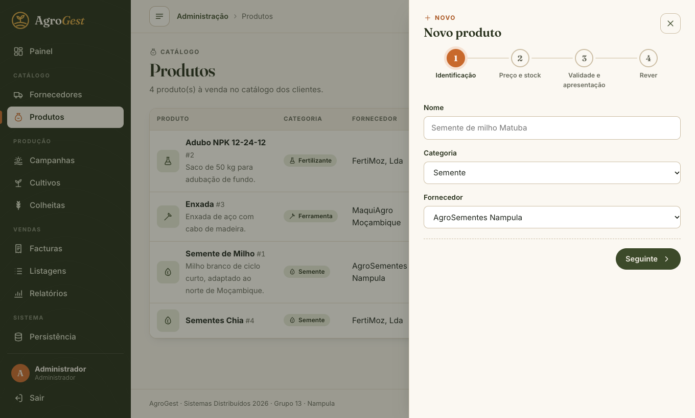

1. **Identificação** :: nome, categoria (`Semente`, `Fertilizante`, `Maquinaria`, `Ferramenta`), fornecedor.
2. **Preço e stock** :: preço > 0, quantidade ≥ 0, unidade (kg, saco, litro, unidade).
3. **Validade e apresentação** :: data de validade (opcional), foto (URL), descrição.
4. **Rever** → **Criar produto** / **Guardar alterações**.
- Produto com validade passada → marcado como expirado, cliente não o consegue comprar.

### Campanhas

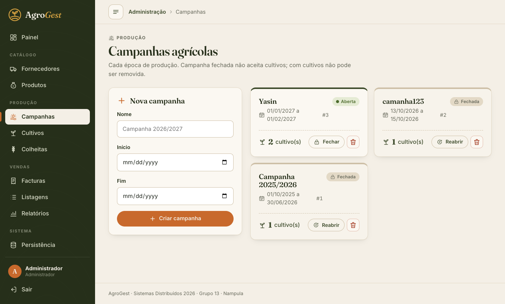

1. **Campanhas** → nome, início, fim (fim ≥ início) → **Criar campanha**.
2. Em cada cartão :: **Fechar** / **Reabrir**, caixote para remover.
- Campanha fechada não aceita cultivos.
- Campanha com cultivos não pode ser removida.

### Cultivos

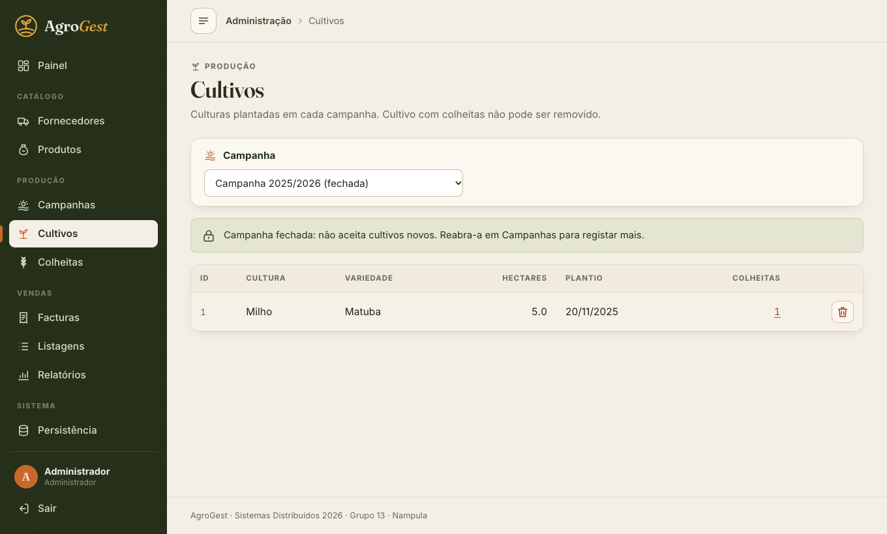

1. **Cultivos** → escolher a campanha no selector.
2. Cultura, variedade, hectares (> 0), data de plantio → **Registar cultivo**.
- Cultivo com colheitas não pode ser removido.

### Colheitas

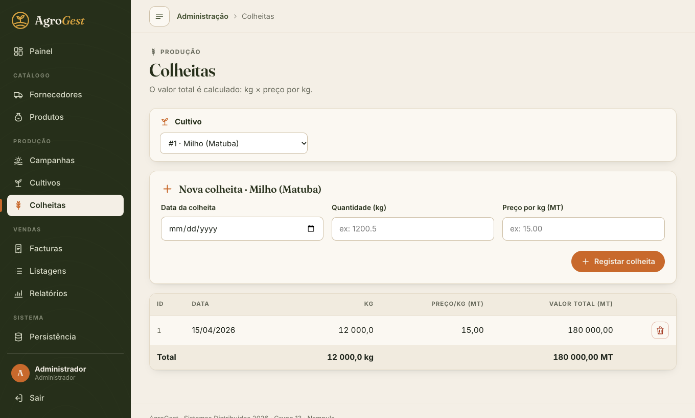

1. **Colheitas** → escolher o cultivo.
2. Data, quantidade (kg > 0), preço por kg (> 0) → **Registar colheita**.
- Valor total = kg × preço/kg, calculado pelo sistema · linha de total no fim da tabela.

### Listagens

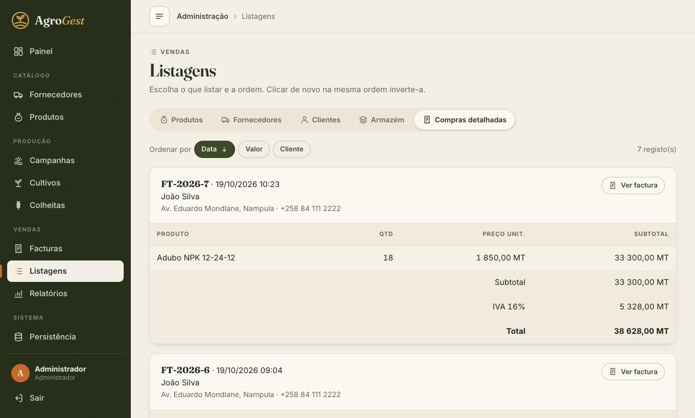

| Tipo | Mostra |
|---|---|
| Produtos | todos os produtos |
| Fornecedores | todos os fornecedores |
| Clientes | contas com perfil cliente |
| Armazém | só produtos com stock > 0 |
| Compras | compras detalhadas :: cliente, endereço, telefone, produtos, qtd, preço unit., subtotal, total, data |

- Ordenar por nome, preço, stock, data ou valor :: botões de ordem no topo · clicar de novo inverte (↑/↓).

### Relatórios

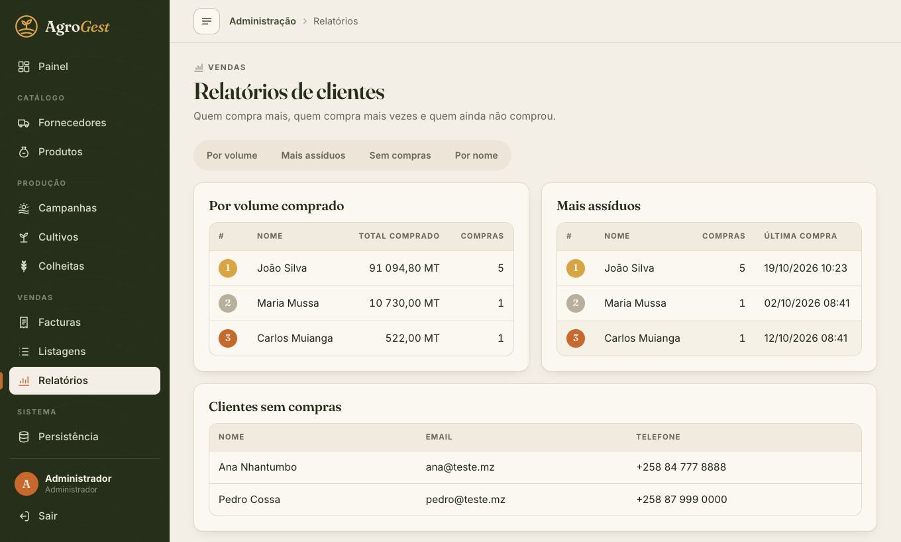

- Clientes por nome (A→Z).
- Clientes que compraram, por volume (soma das compras ↓).
- Clientes mais assíduos (nº de compras ↓).
- Clientes sem compras.

### Facturas

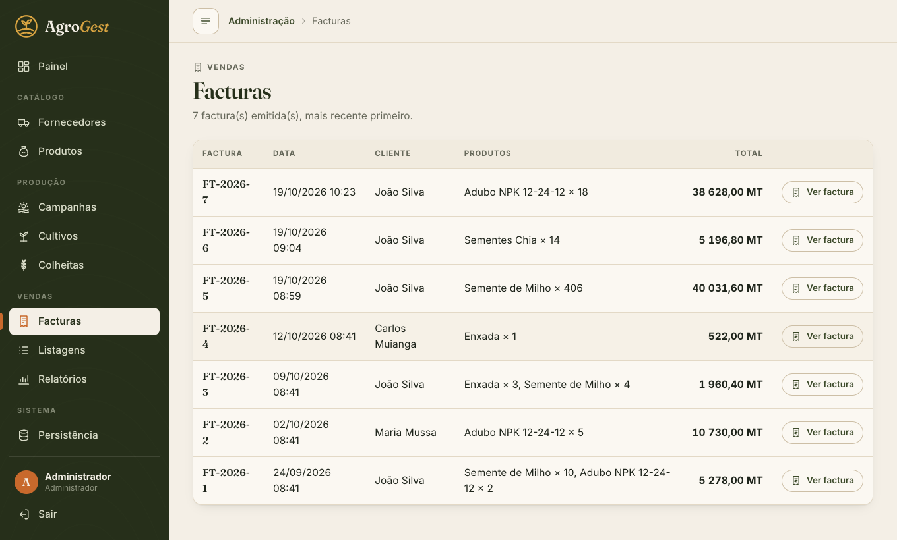

- **Facturas** lista todas as facturas emitidas · clicar abre a factura (admin vê as de todos).

### Persistência

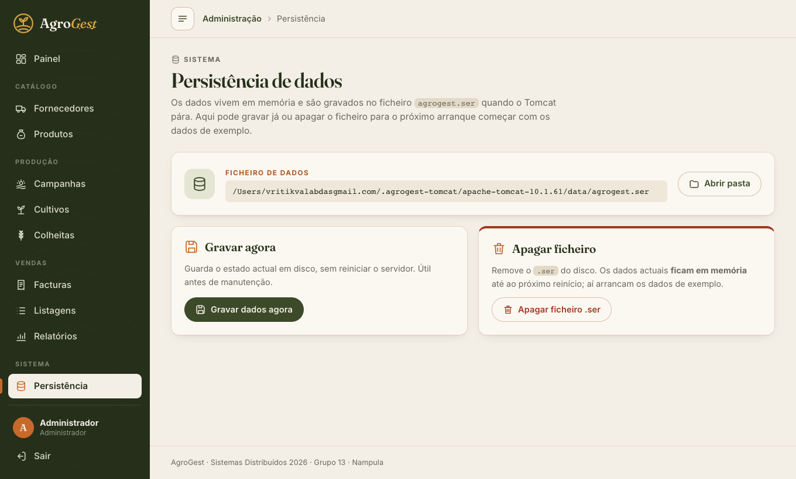

| Botão | Efeito |
|---|---|
| Abrir pasta | abre no SO a pasta do `agrogest.ser` |
| Gravar dados agora | grava o estado actual em disco sem reiniciar |
| Apagar ficheiro .ser | apaga o ficheiro · dados ficam em memória até reiniciar, depois arrancam os dados de exemplo |

- Gravação atómica :: escreve `.tmp` e depois move para `.ser` (ficheiro nunca fica a meio).
- Tomcat a parar (`shutdown.sh`, `systemctl stop agrogest`) grava sozinho.

## 4. Cliente

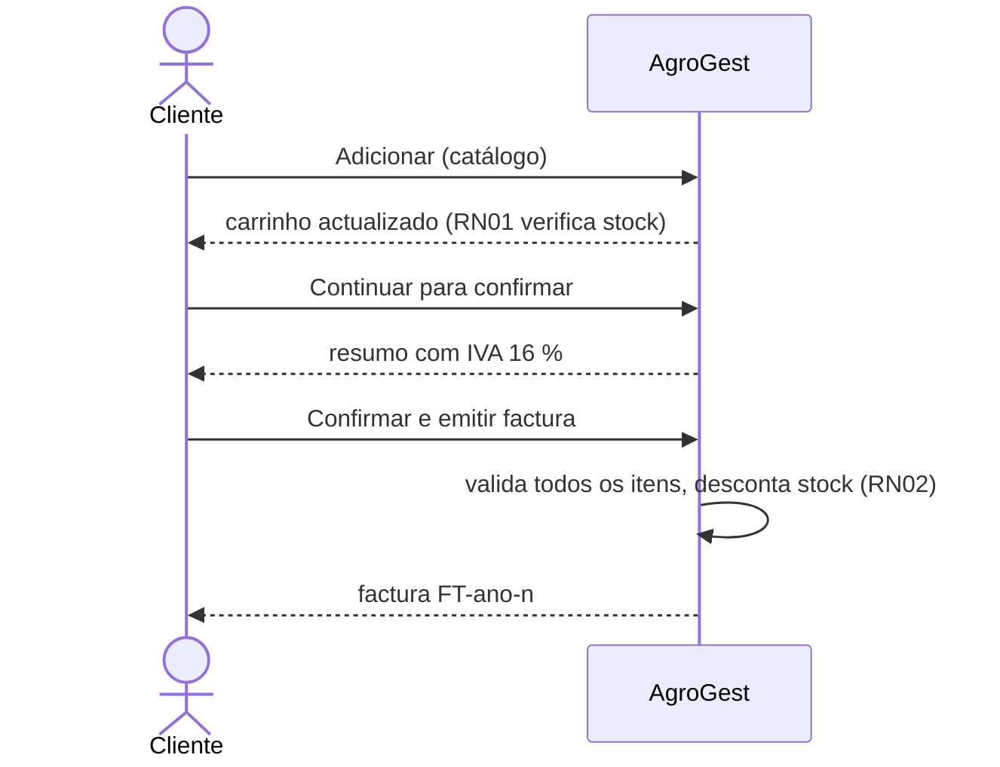

### Catálogo

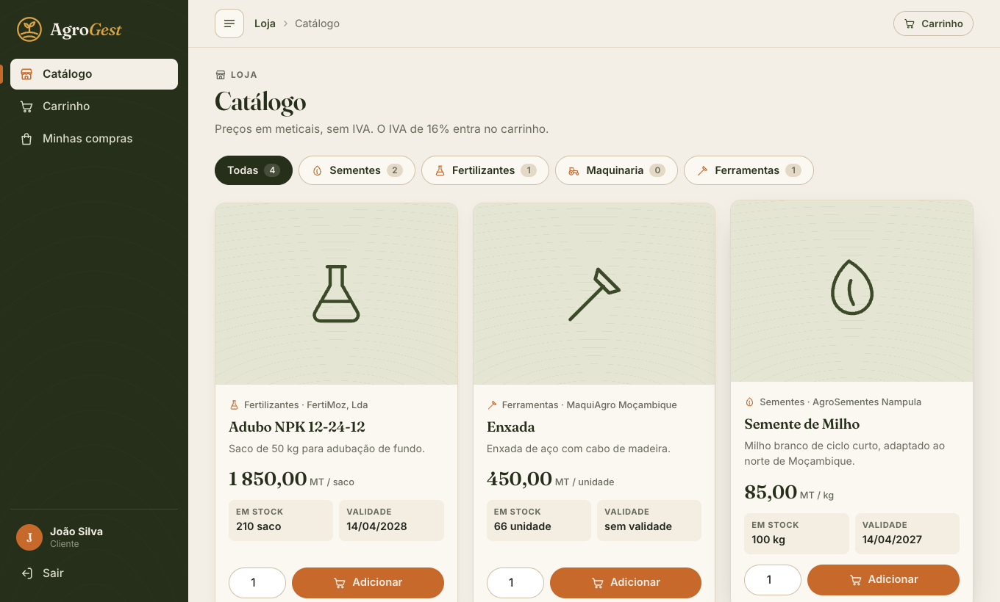

1. **Catálogo** :: cartões com foto, categoria, fornecedor, preço/unidade, stock, validade.
2. Filtro por categoria :: botões no topo (`Todas`, `Sementes`, `Fertilizantes`, `Maquinaria`, `Ferramentas`).
3. Quantidade + **Adicionar** → vai para o carrinho.
- Esgotado / fora da validade → botão desactivado.

### Carrinho

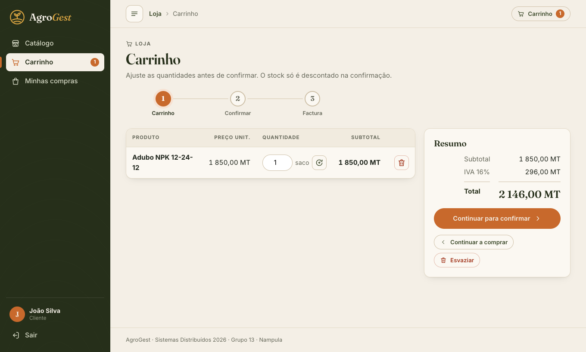

| Acção | Como |
|---|---|
| Alterar quantidade | novo número + ícone ↻ |
| Remover item | ícone do caixote |
| Esvaziar | **Esvaziar** → confirmar |
| Avançar | **Continuar para confirmar** |

- Subtotal, IVA 16 % e total sempre visíveis.
- Quantidade acima do stock → aviso e botão de avançar desactivado (RN01).

### Confirmar compra

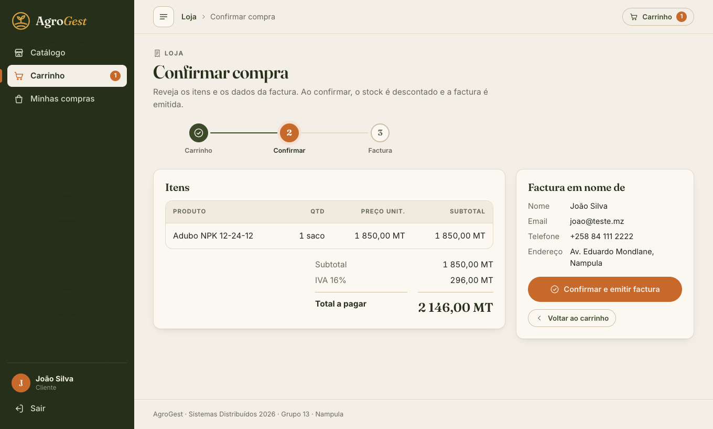

1. Rever itens e totais.
2. **Confirmar e emitir factura**.
- Outro cliente comprou entretanto e o stock já não chega → compra recusada, nada é descontado (RN02).

### Factura

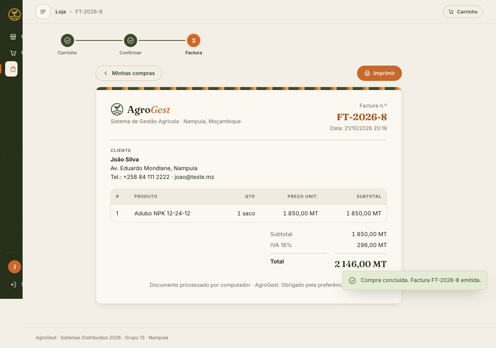

- Número `FT-<ano>-<n>`, data, dados do cliente, itens, subtotal, IVA 16 %, total.
- **Imprimir** :: versão de impressão limpa (sem barra lateral nem botões).

### Minhas compras

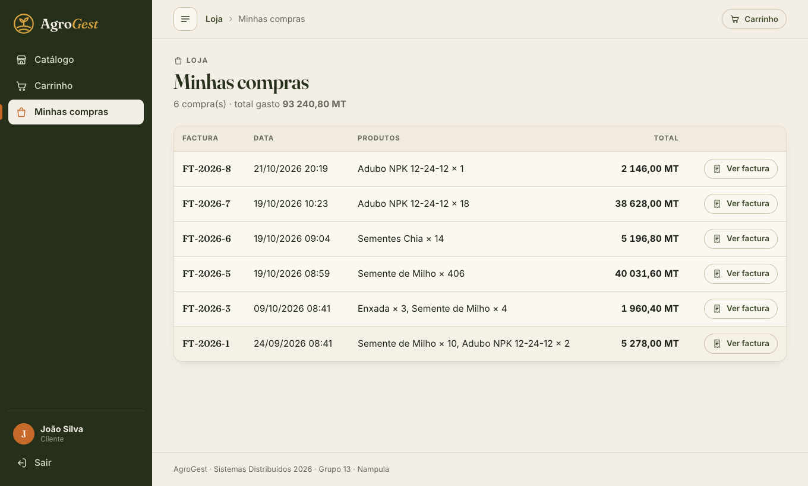

- Histórico só com as compras do próprio cliente · cada linha abre a factura.
- Abrir factura de outro cliente (`/factura?id=` alheio) → 403 (RN03).

### Acesso negado

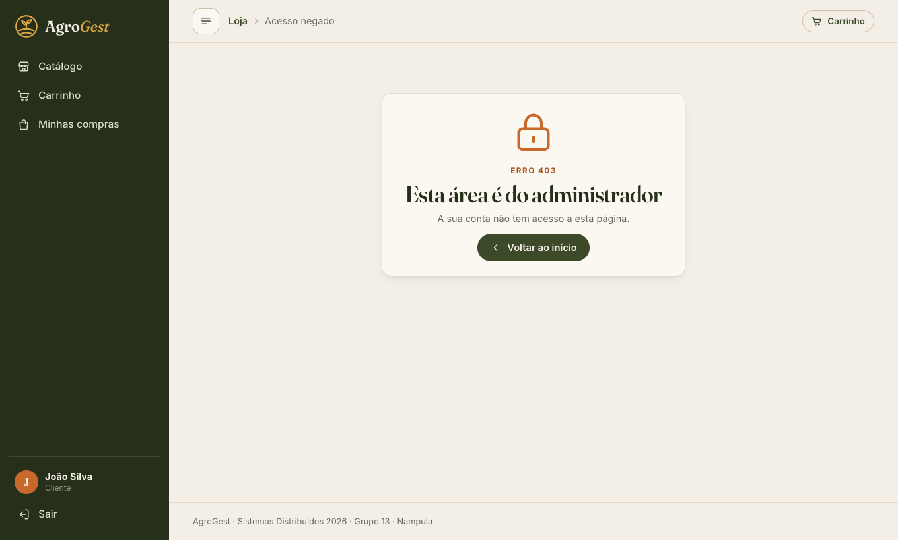

- Cliente a abrir `/admin` → página 403 (RN04).

### Telemóvel

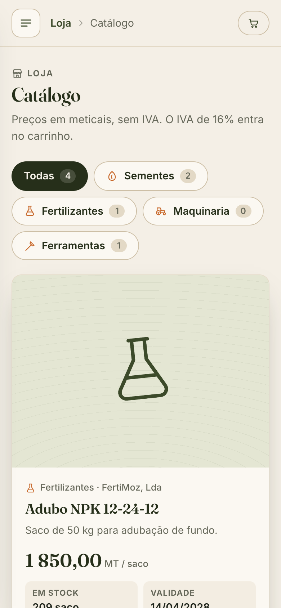

- Interface responsiva :: barra lateral passa a gaveta (botão ☰), cartões em coluna única.
