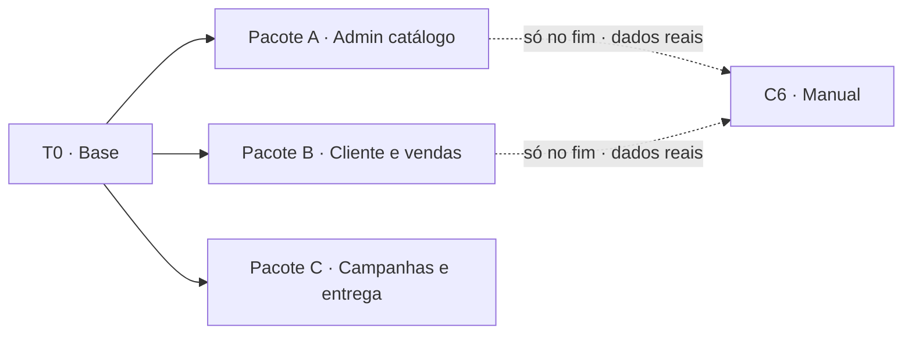

# TODO — AgroGest

Divisão do trabalho em **3 pacotes independentes** (A, B, C) + uma base comum (T0).
Cada pessoa escolhe um pacote. Regras de sessão e CHANGELOG em [CLAUDE.md](../CLAUDE.md).
Requisitos completos: `Docs/Enunciado AgroGest 2026.pdf`.

## Como escolher uma tarefa

1. Na própria branch :: `git pull origin dev` (Yannis/Yasin nunca fazem checkout de `dev`).
2. Na tabela **Estado**, trocar `⬜ livre` por `🔒 <Nome>` no pacote (ou tarefa) escolhido **e**
   pôr o(s) ID(s) na tua linha da coluna Tarefas do `README.md` (tabela Colaboradores).
3. Commit `update: Docs/TODO.md, README.md` e push **imediato** :: Vritik para `dev`; Yannis/Yasin
   para a própria branch + PR para `dev` (reserva fica visível quando o Vritik fizer merge).
4. Trabalhar só nos ficheiros do teu pacote, na tua branch.
5. Tarefa acabada → `✅ <Nome>` no TODO + entrada no `Docs/CHANGELOG-<branch>.md`.

>[!tip] Pacote reservado por outra pessoa = não tocar. Precisas de algo dele? Abre issue/fala no
>grupo; não editas o ficheiro alheio.

## Estado

| ID  | Tarefa                         | Pacote | Estado   |
| --- | ------------------------------ | ------ | -------- |
| T0  | Base comum (bloqueante)        | —      | ✅ Vritik |
| A1  | Fornecedores                   | A      | ✅ Vritik |
| A2  | Produtos + repor stock         | A      | ✅ Vritik |
| A3  | Listagens + compras detalhadas | A      | ✅ Vritik |
| A4  | Relatórios de clientes         | A      | ✅ Vritik |
| A5  | Dashboard admin                | A      | ✅ Vritik |
| A6  | Documento de segurança         | A      | ✅ Vritik |
| A7  | Abrir pasta do `.ser` no SO    | A      | ✅ Vritik |
| A8  | Produto expirado (venda + alerta) | A   | ✅ Vritik |
| A9  | Polimento UI/UX admin e cliente | A     | ✅ Vritik |
| A10 | Editar produto (todos os campos) | A    | ✅ Vritik |
| A11 | Redesign completo da UI (sidebar, wizard, login, SVG) | A | ✅ Vritik |
| A12 | Script `war.sh` (WAR pronto a publicar) | A | 🔒 Vritik |
| B1  | Auto-registo                   | B      | ✅ Yannis |
| B2  | Catálogo com filtro            | B      | ✅ Yannis |
| B3  | Carrinho em sessão             | B      | ✅ Yannis |
| B4  | Compra (RN01 + RN02)           | B      | ✅ Yannis |
| B5  | Factura (RN03 + impressão)     | B      | ✅ Yannis |
| B6  | Minhas compras                 | B      | ✅ Yannis |
| C1  | Campanhas                      | C      | ✅ Yasin  |
| C2  | Cultivos                       | C      | ✅ Yasin  |
| C3  | Colheitas                      | C      | ✅ Yasin  |
| C4  | Persistência `.ser`            | C      | ✅ Yasin  |
| C5  | Deploy Tomcat :8081 + systemd  | C      | ✅ Yasin  |
| C6  | Manual de utilização (`Docs/MANUAL.md`) | C | 🔒 Vritik |

Carga aproximada :: A = 5 ecrãs admin · B = fluxo cliente completo (mais lógica) · C = 3 ecrãs
admin + persistência + deploy + manual.

## Dependências



- Única dependência real :: **T0**. Feito T0 e merge em `dev`, A/B/C não dependem entre si.
- Porquê :: T0 traz modelos, `DataStore` com **dados seed** (fornecedores, produtos, clientes,
  vendas, campanha). A testa listagens com vendas seed sem esperar B; B vende produtos seed sem
  esperar A; C serializa o `DataStore` inteiro sem saber o que A/B lá metem.
- C6 (manual com screenshots) fica para o fim, quando A e B estiverem em `dev`.
- Enquanto T0 não está em `dev` :: os outros podem já escrever código contra os contratos abaixo
  (são fixos) — só não compilam até ao merge.

---

## T0 — Base comum

Uma pessoa só. Fazer primeiro e o mais rápido possível; merge em `dev` desbloqueia os outros.

### Projecto

- Pasta `AgroGest/` já existe (projecto Eclipse, Java 21). Converter para estrutura Maven WAR:
  `pom.xml` + `src/main/java` + `src/main/webapp`.
- `pom.xml` :: `<packaging>war</packaging>`, `finalName` = `agrogest`, Java 17,
  `maven-war-plugin` com `failOnMissingWebXml=false`.

| Dependência | Versão | Scope | Em `AgroGest/lib/` |
|---|---|---|---|
| `jakarta.servlet:jakarta.servlet-api` | 6.0.0 | `provided` (Tomcat já tem) | ✔ |
| `jakarta.servlet.jsp:jakarta.servlet.jsp-api` | 3.1.1 | `provided` | ✔ |
| `jakarta.servlet.jsp.jstl:jakarta.servlet.jsp.jstl-api` | 3.0.0 | compile (vai no WAR) | ✔ |
| `org.glassfish.web:jakarta.servlet.jsp.jstl` | 3.0.1 | compile (vai no WAR, implementação) | ✔ |

- `AgroGest/lib/` serve para quem compila no Eclipse sem Maven. Jars lá sem uso no projecto ::
  `bcel`, `commons-*`, `jakartaee-migration*`, `org.eclipse.osgi` — podem ser removidos.
- JSTL 3.0 usa URIs `jakarta.tags.core` / `jakarta.tags.fmt` (não `http://java.sun.com/...`).

### Ficheiros que T0 cria (depois disto, dono = quem os usa — ver tabela de posse)

| Ficheiro | Conteúdo |
|---|---|
| `model/Utilizador` | `id, nome, email, passHash, perfil, ativo, telefone, endereco` |
| `model/Fornecedor` | `id, nome, tipo, contacto, provincia` |
| `model/Produto` | `id, nome, categoria, fornecedorId, preco, quantidade, unidade, descricao, foto, validade` |
| `model/Campanha` | `id, nome, inicio, fim, fechada, List<Cultivo> cultivos` |
| `model/Cultivo` | `id, campanhaId, cultura, variedade, hectares, plantio, List<Colheita> colheitas` |
| `model/Colheita` | `id, cultivoId, data, kg, precoKg, valorTotal` |
| `model/Venda` | `id, clienteId, data, List<VendaItem> itens, subtotal, iva, total, numeroFactura` |
| `model/VendaItem` | `produtoId, nomeProduto, quantidade, precoUnit, subtotal` |
| `model/Perfil`, `TipoFornecedor`, `Categoria` | enums (ver CLAUDE.md) |
| `repo/DataStore` | singleton, listas + contadores + `seed()` |
| `service/NegocioException` | `RuntimeException` com mensagem para mostrar na JSP |
| `util/PasswordUtil` | `hash(String)` → `"saltBase64:hashBase64"` (SHA-256 + salt 16 bytes), `verificar(pass, guardado)` |
| `filter/AuthFilter` | RN04 + RN05 completos |
| `listener/AppListener` | `contextInitialized` → `DataStore.get().seed()` se vazio. C4 completa depois |
| `servlet/LoginServlet` | `GET/POST /login`, `GET /logout` |
| `webapp/WEB-INF/views/_header.jspf` | `<head>`, CSS, **menu completo** com todos os links (admin e cliente) |
| `webapp/WEB-INF/views/_footer.jspf` | fecho |
| `webapp/WEB-INF/views/login.jsp` | form login + mensagem de erro |
| `webapp/css/style.css` | classes base: `.container .grid .card .btn .btn-danger .tabela .form .alerta .alerta-erro .alerta-ok`, responsivo |

Tipos :: datas `LocalDate` (`Venda.data` = `LocalDateTime`), dinheiro e kg `double`,
quantidade de produto `int`. Todos os modelos `implements Serializable` com `serialVersionUID = 1L`.

>[!tip] `fmt:formatDate` não aceita `LocalDate`. Mostrar `${p.validade}` (ISO) ou acrescentar
>getter `getValidadeFmt()` que devolve `String` `dd/MM/yyyy`.

### Contrato do `DataStore` (fixo — os pacotes programam contra isto)

```java
public final class DataStore implements Serializable {
    public static DataStore get();                 // instância actual
    public static void set(DataStore novo);        // só a Persistencia (C4) usa

    public final List<Utilizador> utilizadores = Collections.synchronizedList(new ArrayList<>());
    public final List<Fornecedor> fornecedores = Collections.synchronizedList(new ArrayList<>());
    public final List<Produto>    produtos     = Collections.synchronizedList(new ArrayList<>());
    public final List<Campanha>   campanhas    = Collections.synchronizedList(new ArrayList<>());
    public final List<Venda>      vendas       = Collections.synchronizedList(new ArrayList<>());

    // RN06 — um AtomicInteger por entidade; serializam com o DataStore (contador restaurado)
    public int nextUtilizadorId(); nextFornecedorId(); nextProdutoId(); nextCampanhaId();
    public int nextCultivoId();    nextColheitaId();   nextVendaId();
    public String nextNumeroFactura();             // "FT-<ano actual>-<n>"

    public Utilizador utilizador(int id); Produto produto(int id); Fornecedor fornecedor(int id);
    public Campanha campanha(int id);     Venda venda(int id);     // null se não existe
    public Utilizador utilizadorPorEmail(String email);

    public void seed();  // admin@agro.mz/admin234, 3 fornecedores, 3 produtos, 5 clientes,
                         // 4 vendas, 1 campanha — igual ao dashboard do enunciado
    public void garantirAdmin();                   // cria admin se faltar (C4 chama depois de carregar)
    public static <T> List<T> copia(List<T> l);    // cópia segura para iterar uma synchronizedList
}
```

### Sessão e rotas (fixo)

| Atributo de sessão | Tipo | Quem escreve |
|---|---|---|
| `utilizador` | `Utilizador` | `LoginServlet` (T0), `RegistoServlet` (B1) |
| `carrinho` | `Map<Integer,Integer>` (`LinkedHashMap`, produtoId → qtd) | B3 |
| `flash` | `String` (mensagem após redirect, JSP mostra e remove) | todos |

- Contexto da app :: `/agrogest` → `http://localhost:8081/agrogest/`.
- Após login :: admin → `/admin`, cliente → `/catalogo`.
- `AuthFilter` :: `/admin/*` sem admin → `403` (`WEB-INF/views/403.jsp`); rotas RN05 sem sessão → redirect `/login`.
  Também põe UTF-8 em todos os pedidos (não é preciso `setCharacterEncoding` nos servlets).

### Convenções da base (T0 feito)

- Seed :: clientes `joao`, `maria`, `carlos`, `ana`, `pedro` `@teste.mz`, todos com pass `1234`
  (`ana` e `pedro` sem compras) · vendas seed já usam `FT-<ano>-1..4`, a próxima é `-5`.
- Escrita que lê e altera (stock, remover com dependências) :: `synchronized (DataStore.get()) { ... }`.
  Mesmo lock para todos — a venda (B4) e o repor stock (A2) mexem no mesmo `Produto.quantidade`.
- Erro de regra :: service lança `NegocioException` → servlet faz `req.setAttribute("erro", msg)` e
  `forward` para a JSP (o `_header.jspf` mostra `${erro}` e o `flash` de sessão).
- JSP :: 1.ª linha `<%@ page pageEncoding="UTF-8" %>`, `<c:set var="titulo">`, opcional
  `<c:set var="estilos" value="${['cliente-b.css']}"/>`, depois `<%@ include file="_header.jspf" %>`.
  O header já declara `c`, `fmt`, `fn` e `ctx` (= context path).
- Texto vindo do utilizador :: sempre `<c:out>` ou `fn:escapeXml` (EL `${}` não escapa HTML).
- Datas :: `getXxxFmt()` nos modelos (`dd/MM/yyyy`; `Venda.getDataFmt()` com hora).

### Feito quando

- `mvn package` gera `target/agrogest.war` · deploy no Tomcat abre `/login` · login admin e
  cliente seed funcionam · `/admin` como cliente dá 403 · menu mostra todos os links (404 é
  normal até os pacotes existirem).

---

## Pacote A — Admin: catálogo, listagens, relatórios

Ficheiros do pacote :: `service/FornecedorService`, `service/ProdutoService`,
`service/RelatorioService`, `servlet/admin/{Fornecedor,Produto,Listagem,Relatorio,Dashboard}Servlet`,
`views/admin/{fornecedores,produtos,listagens,relatorios,dashboard}.jsp`, `css/admin-a.css`.

| ID | Rota | Requisitos | Validações / regras |
|---|---|---|---|
| A1 | `/admin/fornecedores` | criar, listar, remover · campos `nome, tipo, contacto, provincia` | campos obrigatórios · não remover fornecedor com produtos (mensagem) |
| A2 | `/admin/produtos` | criar, listar, repor stock (`+qtd`), remover · todos os campos de `Produto` · `<select>` de fornecedores e categorias | preço > 0, quantidade ≥ 0, validade data válida, fornecedor existe · escrita `synchronized` |
| A3 | `/admin/listagens?tipo=&ordem=` | `tipo` ∈ `produtos, fornecedores, clientes, armazem, compras` · `ordem` ∈ `nome, preco, stock, data, valor` | `armazem` = stock > 0 · `compras` = compras detalhadas: cliente, endereço, telefone, produtos, qtd, preço unit., subtotal, total, data |
| A4 | `/admin/relatorios` | clientes por nome ↑ · clientes que compraram por volume (soma `total`) ↓ · mais assíduos (nº compras) ↓ · extra: clientes sem compras | só perfil `CLIENTE` · `Comparator` + streams |
| A5 | `/admin` | contagens: fornecedores, produtos, clientes, vendas, campanhas · links para cada módulo | — |
| A6 | `SECURITY.md` (raiz) | política GitHub (reportar, versões, protecção do repo) · medidas da app · config Tomcat · limitações · checklist | `.github/dependabot.yml` · workflow com `permissions: {}` · sem alterar código Java |

| A8 | `/catalogo`, `/carrinho`, `/compra`, `/admin`, `/admin/produtos` | cliente não compra produto com `validade` < hoje · admin vê alerta de expirados no dashboard e na lista de produtos | `Produto.isExpirado()` (getter calculado, sem campo novo) · bloqueio em `VendaService` (RN01: adicionar, actualizar, finalizar) |
| A9 | todas | polimento visual: menu com página activa, cartões, tabelas, forms, alertas, responsivo | só CSS/JSP · sem frameworks · mesmo layout |
| A10 | `POST /admin/produtos` `acao=editar` | editar todos os campos do produto (nome, categoria, fornecedor, preço, stock, unidade, validade, foto, descrição) | mesmas validações do criar · escrita `synchronized` no lock do `DataStore` |
| A11 | todas | redesign completo: paleta terra/savana, sidebar retráctil com botão de menu, login novo, wizard em produto/registo/compra, ícones SVG (animados), sem emoji | só CSS/JSP/JS próprio · sem frameworks |
| A12 | `war.sh` (raiz) | `mvn clean package` → `agrogest.war` pronto a copiar para `webapps/` | Java 17+ e Maven verificados · sem tocar em código Java |

A8–A11 tocam ficheiros do pacote B (`VendaService`, `catalogo.jsp`, `cliente-b.css`) e partilhados
(`Produto`, `_header.jspf`, `style.css`) :: B já ✅, decisão do Vritik (dono do repo).

Testar sem B :: vendas e clientes seed chegam para A3/A4.

---

## Pacote B — Cliente e vendas

Ficheiros do pacote :: `service/ClienteService`, `service/CatalogoService`, `service/VendaService`,
`servlet/{Registo,Catalogo,Carrinho,Compra,Factura,MinhasCompras}Servlet`,
`views/{registo,catalogo,carrinho,compra,factura,minhas-compras}.jsp`, `css/cliente-b.css`.

| ID | Rota | Requisitos | Validações / regras |
|---|---|---|---|
| B1 | `/registo` | `nome, email, pass, telefone, endereco` · perfil `CLIENTE` · login automático | email único (`synchronized`) · pass guardada com `PasswordUtil.hash` |
| B2 | `/catalogo?categoria=` | cards: nome, descrição, foto, preço, validade, stock, fornecedor, categoria · filtro por categoria | só produtos com stock > 0 com botão "adicionar" activo |
| B3 | `/carrinho`, `POST /carrinho/{add,update,remove,limpar}` | carrinho em sessão · linhas com subtotal e total | qtd > 0 · aviso se qtd > stock (RN01) · PRG após cada POST |
| B4 | `GET /compra` (confirmar) · `POST /compra` (finalizar) | resumo + confirmar · cria `Venda`, esvazia carrinho, redirect para factura | **RN01** stock insuficiente → mensagem na JSP · **RN02** `VendaService.finalizar` `synchronized`, valida tudo antes de descontar (ver CLAUDE.md) |
| B5 | `/factura?id=` | `FT-<ano>-<n>`, dados do cliente, itens, subtotal, IVA 16 %, total · botão imprimir (`window.print()`) · `@media print` esconde menu | **RN03** cliente só a sua (outra → 403) · admin vê todas |
| B6 | `/minhas-compras` | histórico do cliente com link para cada factura | só vendas de `clienteId` da sessão |

IVA :: `subtotal = Σ itens`, `iva = subtotal × 0.16`, `total = subtotal + iva`.
Testar sem A :: produtos seed chegam para B2–B6.

---

## Pacote C — Campanhas, persistência, entrega

Ficheiros do pacote :: `service/CampanhaService`, `repo/Persistencia`, `listener/AppListener`
(completar), `servlet/admin/{Campanha,Cultivo,Colheita,Persistencia}Servlet`,
`views/admin/{campanhas,cultivos,colheitas,persistencia}.jsp`, `css/admin-c.css`, `Docs/deploy/**`,
`Docs/Manual AgroGest.pdf`.

| ID | Rota | Requisitos | Validações / regras |
|---|---|---|---|
| C1 | `/admin/campanhas` | criar (`nome, inicio, fim`), listar, fechar, reabrir, remover | `fim` ≥ `inicio` · **não remover com cultivos** |
| C2 | `/admin/cultivos?campanha=` | registar `cultura, variedade, hectares, plantio` na campanha | hectares > 0 · campanha fechada não aceita cultivos · **não remover com colheitas** |
| C3 | `/admin/colheitas?cultivo=` | registar `data, kg, precoKg` | `valorTotal = kg × precoKg` calculado no service · kg > 0, precoKg > 0 |
| C4 | `/admin/persistencia` | botões "gravar agora" e "apagar ficheiro" · `AppListener`: init carrega `.ser` (senão `seed()`), garante admin; destroy grava | escrita atómica `.tmp` → `Files.move(ATOMIC_MOVE, REPLACE_EXISTING)` · ficheiro corrompido → log + `seed()`, não rebenta o arranque · caminho do `.ser` em `${catalina.base}/data/agrogest.ser` |
| C5 | — | Tomcat 10.1 `server.xml` porta **8081** · `Docs/deploy/agrogest.service` (systemd: `User=tomcat`, `ExecStart/ExecStop` com `startup.sh`/`shutdown.sh`, `Restart=on-failure`) · secção Deploy no `README.md` | testar `systemctl stop` grava o `.ser` (contextDestroyed) |
| C6 | — | `Docs/MANUAL.md` (reatribuída a Vritik) :: passo a passo admin (fluxo do enunciado secção VIII) + cliente (registo → factura → histórico), com screenshots | **no fim**, depois de A e B em `dev` |

Testar C4 sem A/B :: gravar com dados seed, reiniciar Tomcat, confirmar que IDs continuam a
partir do último (contadores restaurados).

---

## Ficheiros partilhados

| Ficheiro | Regra |
|---|---|
| `_header.jspf` (menu) | T0 já põe todos os links. Mudança → combinar no grupo |
| `css/style.css` | T0. Estilo próprio vai para o `css/*-a/b/c.css` do pacote |
| `model/*`, `DataStore` | Contrato fixo. Campo novo só com acordo dos 3 (afecta serialização) |
| `README.md` | Cada pacote acrescenta só a sua secção · coluna Tarefas: cada um só a sua linha |
| `pom.xml` | T0. Dependência nova = proibido sem acordo (enunciado: sem frameworks) |
