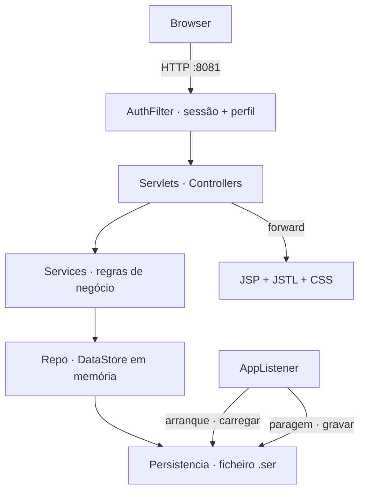

# AgroGest — Sistema de Gestão Agrícola

Trabalho prático de **Sistemas Distribuídos** · Engenharia Informática · 2026 · **Grupo 13**.

Aplicação web para um agricultor de Nampula: gere fornecedores, produtos, campanhas agrícolas,
cultivos e colheitas, e vende produtos em stock a clientes com emissão de factura.
Java + Servlets no Apache Tomcat, **sem base de dados** (listas em memória + serialização em ficheiro).

## Colaboradores

| Nome            | GitHub                                               | Branch | Tarefas                |
| --------------- | ---------------------------------------------------- | ------ | ---------------------- |
| Vritik Valabdas | [@vritik246800](https://github.com/vritik246800)     | `vd`   | T0, A1, A2, A3, A4, A5, A6, A7, A8, A9, A10, A11, A12, A13, C6 |
| Yannis Chilundo | [@yannischilundo](https://github.com/yannischilundo) | `yc`   | B1, B2, B3, B4, B5, B6 |
| Yasin Magno     | [@yasinmagno](https://github.com/yasinmagno)         | `ym`   | C1, C2, C3, C4, C5 |

Tarefas :: IDs do [Docs/TODO.md](Docs/TODO.md) reservados por cada um. Reservar = `🔒 <Nome>` no
TODO **e** ID na tua linha aqui, no mesmo commit (`update: Docs/TODO.md, README.md`).

## Funcionalidades

| Perfil | Módulos |
|---|---|
| Administrador | fornecedores · produtos (editar, repor stock, alerta de expirados) · campanhas · cultivos · colheitas · listagens com ordenação · compras detalhadas · relatórios de clientes · dashboard · persistência manual |
| Cliente | auto-registo · catálogo com filtro por categoria · carrinho · compra · factura `FT-<ano>-<n>` com IVA 16 % · histórico |

Regras de negócio :: RN01 sem venda acima do stock · RN02 venda atómica (tudo ou nada) ·
RN03 cliente só vê as suas facturas · RN04 `/admin/*` só admin (HTTP 403) · RN05 rotas de
cliente exigem sessão · RN06 IDs sequenciais via `AtomicInteger`.

## Tecnologias

| Camada | Tecnologia |
|---|---|
| Linguagem | Java 17+ |
| Servidor | Apache Tomcat 10.1 (porta **8081**) |
| Controladores / filtros / listeners | Jakarta Servlets 6.0 (`@WebServlet`, `@WebFilter`, `@WebListener`) |
| Vista | JSP + JSTL 3.0 + EL · HTML5 + CSS3 próprio |
| Dados | `ArrayList` / `Map` / `Collections.synchronizedList` |
| Persistência | `ObjectOutputStream` / `ObjectInputStream` → ficheiro `.ser` (escrita atómica) |
| Build | Apache Maven (WAR) |

## Arquitectura



```
AgroGest/src/main/
├── java/mz/agrogest/
│   ├── model/      POJOs Serializable + enums
│   ├── repo/       DataStore, Persistencia
│   ├── service/    regras de negócio
│   ├── servlet/    controllers (admin/ para /admin/*)
│   ├── filter/     AuthFilter
│   ├── listener/   AppListener
│   └── util/       PasswordUtil
└── webapp/
    ├── css/
    └── WEB-INF/views/   JSP
```

## Instalação e deploy

```bash
./war.sh                                      # mvn clean package + verifica o WAR → AgroGest/target/agrogest.war
cp AgroGest/target/agrogest.war $CATALINA_HOME/webapps/
$CATALINA_HOME/bin/startup.sh
```

Abrir `http://localhost:8081/agrogest/`.
Desenvolvimento local :: `./run.sh` compila, descarrega Tomcat 10.1 se faltar, publica e arranca em `:8081`.
Tomcat na porta 8081 — alterar `conf/server.xml`: `port="8080"` → `port="8081"`.

Release :: `git tag v1.0.0 && git push origin v1.0.0` → GitHub Actions compila e publica `agrogest.war` (+ `.sha256`) em *Releases*.

Deploy com systemd (Linux) :: ver [`Docs/deploy/DEPLOY.md`](Docs/deploy/DEPLOY.md) e [`Docs/deploy/agrogest.service`](Docs/deploy/agrogest.service).

## Credenciais de teste

| Perfil  | Email                                                                    | Password   |
| ------- | ------------------------------------------------------------------------ | ---------- |
| Admin   | `admin@agro.mz`                                                          | `admin234` |
| Cliente | `joao@teste.mz`                                                          | `1234`     |
| Cliente | `maria@teste.mz` · `carlos@teste.mz` · `ana@teste.mz` · `pedro@teste.mz` | `1234`     |

## Cliente (pacote B)

| Rota | O que faz | Regras |
|---|---|---|
| `GET/POST /registo` | auto-registo (nome, email, telefone, endereço, palavra-passe) e entrada automática | email único · palavra-passe guardada só como hash |
| `GET /catalogo?categoria=` | produtos em cartões (foto, preço, validade, stock, fornecedor), filtro por categoria | esgotado = sem botão de adicionar |
| `GET /carrinho` · `POST /carrinho/{add,update,remove,limpar}` | carrinho na sessão com subtotal, IVA 16 % e total | RN01: quantidade acima do stock recusada com aviso |
| `GET/POST /compra` | rever, confirmar e emitir a factura | RN01 + RN02: valida todos os itens e só depois desconta o stock (`synchronized`) |
| `GET /factura?id=` | factura `FT-<ano>-<n>` imprimível | RN03: cliente só vê as suas (403), admin vê todas · `/factura` sem id = lista do admin |
| `GET /minhas-compras` | histórico com link para cada factura | só as compras do cliente da sessão |

## Documentação

Índice de `Docs/` :: [[Docs/INDEX]].

| Ficheiro | Conteúdo |
|---|---|
| [Docs/Enunciado AgroGest 2026.pdf](Docs/Enunciado%20AgroGest%202026.pdf) | enunciado |
| [Docs/TODO.md](Docs/TODO.md) | divisão do trabalho e contratos comuns |
| [Docs/BRANCH.md](Docs/BRANCH.md) | regras de branch e merge |
| [Docs/INSTRUCOES.md](Docs/INSTRUCOES.md) | passo a passo para Yannis e Yasin (sincronizar, PR, proibido) |
| [SECURITY.md](SECURITY.md) | política de segurança: reportar vulnerabilidades, protecção do repo GitHub, medidas da app, limitações |
| [Docs/CHANGELOG.md](Docs/CHANGELOG.md) | alterações (consolidado de `CHANGELOG-vd/yc/ym.md`) |
| [Docs/MANUAL.md](Docs/MANUAL.md) | manual de utilização admin + cliente, com screenshots (`Docs/img/manual/`) |
