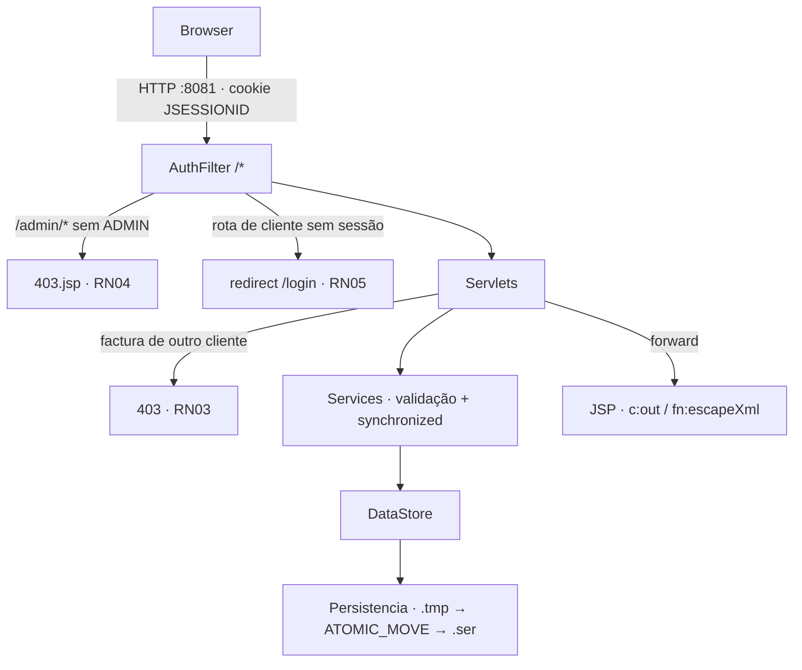

# Política de segurança — AgroGest

Como reportar vulnerabilidades, como o repositório está protegido, medidas de segurança da aplicação
e limitações conhecidas. Estado do branch `dev` em 2026-10-14.

## Versões suportadas

| Versão | Branch | Suportada |
|---|---|---|
| `1.0` (`pom.xml`) | `main` | ✅ |
| desenvolvimento | `dev` | ✅ correcções entram aqui primeiro |
| branches pessoais | `vd`, `yc`, `ym` | ❌ |

## Reportar uma vulnerabilidade

>[!question] Encontraste uma falha de segurança?
>Não abrir issue pública nem PR com o exploit. Reportar em privado.

1. Separador **Security** → **Report a vulnerability**
   (`https://github.com/vritik246800/Trabalho-Pratico-SD/security/advisories/new`).
2. Incluir :: rota afectada, passos para reproduzir, impacto, versão/commit.
3. Resposta em até 7 dias · correcção em `dev` → `main` · crédito no `Docs/CHANGELOG.md` se quiseres.

| Fora de âmbito | Motivo |
|---|---|
| Credenciais de teste do `README.md` (`admin@agro.mz` / `admin234`, clientes `1234`) | exigidas pelo enunciado, só para demo |
| L1–L11 da secção [Limitações conhecidas](#limitações-conhecidas) | já documentadas |
| Ataques que exigem acesso de escrita ao servidor ou ao disco | fora do modelo de ameaça |

## Segurança do repositório GitHub

### Aplicado por ficheiro (já no repositório)

| Ficheiro | O que faz |
|---|---|
| `.github/CODEOWNERS` | `* @vritik246800` :: todo PR pede revisão do dono |
| `.github/workflows/main-only-from-dev.yml` | PR para `main` só aceite vindo de `dev` · `permissions: {}` (token sem permissões) |
| `.github/dependabot.yml` | actualizações semanais de dependências Maven (`AgroGest/`) e GitHub Actions, PR para `dev` · ignora saltos de Servlet/JSP API (Tomcat 10.1 = Servlet 6.0) |
| `.gitignore` | `*.ser`, `target/`, `*.class` :: dados de utilizadores e builds nunca entram no git · `/.metadata/` :: workspace do Eclipse (logs com caminhos locais) fora do git |
| `SECURITY.md` | esta política · aparece em **Security → Policy** |

### Activar nas definições (só o dono — `Settings`)

| Onde | Definição | Porquê |
|---|---|---|
| `Settings → Rules → Rulesets` (ou `Branches`) · `main` | require PR · 1 aprovação · require review from Code Owners · require status check `check-source` · block force push · restrict deletions | só `dev → main`, sem reescrever histórico |
| idem · `dev` | require PR (bypass só Vritik) · block force push · restrict deletions | `yc`/`ym` entram só por PR |
| `Settings → Code security` | **Private vulnerability reporting** ON | activa o botão "Report a vulnerability" |
| idem | **Dependabot alerts** + **Dependabot security updates** ON | aviso de CVE nas dependências |
| idem | **Secret scanning** + **Push protection** ON | bloqueia push com tokens/passwords |
| idem | **Code scanning** · CodeQL default setup | análise estática Java · grátis em repo público |
| `Settings → Actions → General` | workflow permissions = **Read repository contents** · não deixar Actions aprovar PRs | token mínimo por omissão |
| `Settings → Collaborators` | `yannischilundo`, `yasinmagno` com **Write** (não Admin) | não mudam regras nem settings |
| Conta de cada colaborador | 2FA activo | conta roubada = push no repo |

### Regras para quem contribui

- Nunca commitar :: passwords reais, tokens, chaves (`*.pem`, `*.key`), `.env`, ficheiros `.ser` com dados.
- Segredo commitado por engano :: **rodar o segredo primeiro** (apagar do histórico não chega), avisar o Vritik.
- Push por SSH ou HTTPS com token · nunca a password da conta.
- Dependência nova só com acordo do grupo (`pom.xml` é ficheiro partilhado) e versão fixa.

---

# Segurança da aplicação

>[!question] O que protege o AgroGest, e contra quê?
>Contas (hash), rotas (filtro + perfil), dados de outros clientes (RN03), stock (locks), ficheiro `.ser` (escrita atómica) e HTML (escape).

## Visão geral



## Medidas implementadas

| Área | Medida | Onde |
|---|---|---|
| Passwords | SHA-256 + salt aleatório de 16 bytes (`SecureRandom`) por utilizador · guardado `saltBase64:hashBase64` · nunca texto puro | `util/PasswordUtil` |
| Comparação de hash | `MessageDigest.isEqual` :: tempo constante, sem timing attack | `PasswordUtil.verificar` |
| Login | mesma mensagem para email inexistente e pass errada :: não revela contas · conta `ativo=false` recusada | `servlet/LoginServlet` |
| Session fixation | `invalidate()` + sessão nova depois de login válido | `LoginServlet.doPost` |
| Logout | `session.invalidate()` | `LoginServlet` (`/logout`) |
| RN04 · admin | `/admin` e `/admin/...` sem perfil `ADMIN` :: **HTTP 403** · `/administracao` não apanhado por engano (`debaixo()`) | `filter/AuthFilter` |
| RN05 · sessão | `/catalogo`, `/carrinho/*`, `/compra`, `/factura`, `/minhas-compras` sem sessão :: redirect `/login` | `AuthFilter` |
| RN03 · facturas | cliente só vê as suas (outra :: 403) · admin vê todas · id inválido :: 404 | `servlet/FacturaServlet` + `VendaService.podeVer` |
| Vistas | JSP em `WEB-INF/views/` :: sem acesso por URL directo | `webapp/WEB-INF/views` |
| XSS | dados do utilizador sempre via `<c:out>` / `fn:escapeXml` · sem scriptlets | todas as JSP |
| Foto de produto | só URL `http://` ou `https://` :: bloqueia `javascript:` em `src` | `ProdutoService` |
| Validação de entrada | campos obrigatórios, tamanho máximo, regex de email e telefone, números positivos | services (`NegocioException`) |
| Erros | `NegocioException` :: mensagem na JSP, nunca stack trace | servlets |
| Email único | verificação + inserção no mesmo `synchronized (ds)` :: dois registos iguais em simultâneo não passam | `ClienteService.registar` |
| RN01 + RN02 | lock do carrinho + lock do `DataStore` · valida todos os itens antes de descontar (tudo ou nada) · duplo clique não compra duas vezes | `VendaService.finalizar` |
| Sessão obsoleta | após restauro do `.ser`, venda recusada se o id da sessão já não corresponde ao mesmo email | `VendaService.finalizar` |
| Concorrência | toda a escrita partilhada em `synchronized (ds)` · carrinho com lock da sessão | services, `CarrinhoServlet` |
| RN06 · IDs | `AtomicInteger` por entidade, restaurado depois de desserializar | `repo/DataStore` |
| Persistência | grava em `agrogest.tmp`, depois `Files.move(..., ATOMIC_MOVE, REPLACE_EXISTING)` :: crash a meio não corrompe o `.ser` | `repo/Persistencia` |
| `.ser` corrompido | excepção apanhada :: arranca com `seed()` em vez de falhar | `Persistencia.carregar` |
| Gravar/apagar dados | só `POST` em `/admin/persistencia` (protegido por RN04) | `servlet/admin/PersistenciaServlet` |
| Encoding | UTF-8 forçado em pedido e resposta | `AuthFilter` |

```java
// PasswordUtil — salt novo por utilizador, comparação em tempo constante
byte[] salt = new byte[16];
RANDOM.nextBytes(salt);                                   // SecureRandom
return b64(salt) + ":" + b64(sha256(salt, pass));
...
return MessageDigest.isEqual(guardado, sha256(salt, pass)); // não usa Arrays.equals
```

## Configuração do Tomcat (por omissão)

| Item | Valor | Nota |
|---|---|---|
| Porta | HTTP `8081` | `conf/server.xml` |
| Timeout de sessão | 30 min | `conf/web.xml` `<session-timeout>` |
| Cookie `JSESSIONID` | `HttpOnly` | omissão do Tomcat :: JavaScript não lê o cookie |
| Cookie `Secure` | não | só HTTP |
| `SameSite` | não definido | ver limitações |

## Limitações conhecidas

| # | Limitação | Risco | Mitigação proposta |
|---|---|---|---|
| L1 | Sem HTTPS :: password e `JSESSIONID` em claro na rede | alto em rede partilhada | reverse proxy com TLS (nginx) ou conector `8443` com certificado · cookie `Secure` |
| L2 | Sem token CSRF nos formulários `POST` | médio :: site externo pode submeter acções com a sessão do admin | `SameSite=Lax` no cookie (`<CookieProcessor sameSiteCookies="lax"/>` em `context.xml`) ou token por sessão em campo hidden |
| L3 | SHA-256 com uma só iteração :: hash rápido, força bruta barata se o `.ser` vazar | médio | PBKDF2 (`PBKDF2WithHmacSHA256`, ≥ 600 000 iterações) via `SecretKeyFactory` |
| L4 | Password mínima de 4 caracteres | médio | mínimo 8 |
| L5 | Sem limite de tentativas de login | médio :: força bruta online | contador por email/IP com bloqueio temporário |
| L6 | Admin fixo `admin@agro.mz` / `admin234` (exigido pelo enunciado) | alto fora da demo | mudar password no primeiro arranque em produção |
| L7 | `ObjectInputStream` sem `ObjectInputFilter` | baixo :: exige escrita em `${catalina.base}/data/` | filtro com allowlist `mz.agrogest.*;java.base/*;!*` |
| L8 | `.ser` sem cifra :: emails, telefones e hashes legíveis por quem lê o disco | baixo | permissões `600` no ficheiro · utilizador `tomcat` dedicado (systemd) |
| L9 | `/logout` por `GET` | baixo :: logout forçado por link | `POST` com formulário |
| L10 | Foto de produto carregada de URL externo | baixo :: servidor externo vê IP do cliente | guardar imagens em `webapp/img/` |
| L11 | Registo diz "já existe conta com o email" :: enumeração de contas | baixo · aceite (email único é requisito) | — |

>[!tip] Para a demo: L1, L2 e L6 são as perguntas mais prováveis. Resposta curta :: HTTPS e CSRF ficam no proxy/cookie `SameSite`, admin fixo é requisito do enunciado.

## Checklist rápida

| Verificação | Comando / passo | Esperado |
|---|---|---|
| RN04 | `curl -o /dev/null -w '%{http_code}' localhost:8081/agrogest/admin` | `403` |
| RN05 | `curl -I localhost:8081/agrogest/catalogo` | `302` → `/login` |
| RN03 | cliente A abre `/factura?id=<factura de B>` | `403` |
| RN01 | adicionar ao carrinho quantidade > stock | aviso "Stock insuficiente…" |
| Hash | abrir `.ser` / depurar `Utilizador.passHash` | formato `salt:hash`, sem password |
| XSS | criar fornecedor com nome `<script>alert(1)</script>` | texto aparece literal |
